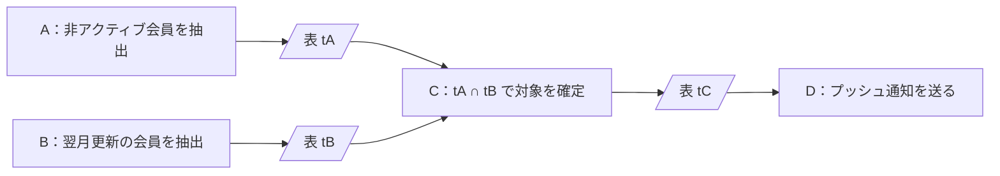
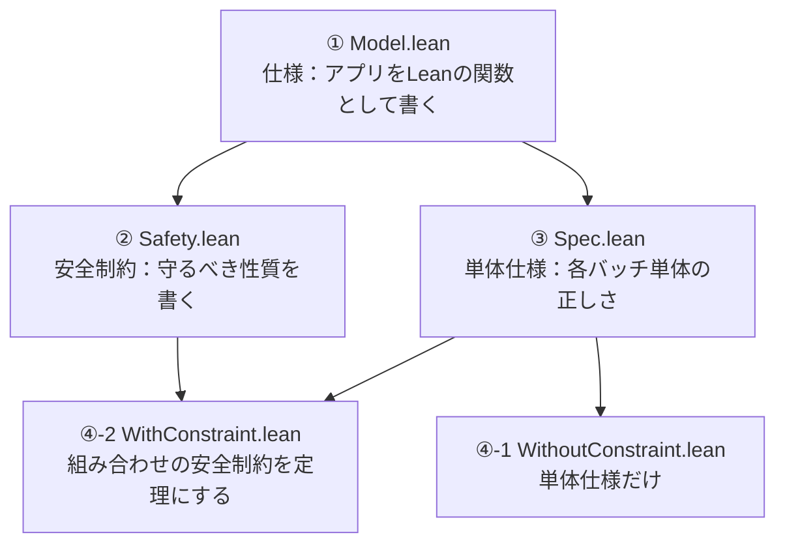

## はじめに

Google の『Site Reliability Engineering』第2版に、「Safety Engineering for SRE with STPA and CAST」という章が加わりました。STAMP/STPA はシステム安全工学から生まれた考え方と分析手法で、Google では2021年に社内研修が始まり、2025年の SREcon では Google Maps への適用事例も紹介されています（[STPA: Teaching a New Way to Prevent Outages at Google](https://sre.google/stpa/teaching/)）。こうした流れと、STPA を SRE の実務にどう使うかは、[STAMP/STPA を SRE の視点で解説した記事](https://zenn.dev/maruloop/articles/7ff108e29741b5)で詳しく紹介されています。

この記事では、その STPA の考え方を、定理証明支援系の Lean で形式化します。特に、STPA の中心にある「部品は正常に動いているのに、組み合わせると事故が起きる」というハザードの捉え方を、Lean の定理として書いてみます。

## この記事で伝えたいこと

Lean では、アプリの仕様と、満たすべき安全制約をコードとして書けます。

一般的なプログラミング言語では、テストは「書いた入力」についてしか確かめられません。Lean では、**安全制約を定理として書くと、それが成り立たない可能性のある箇所がビルドエラーになります。** しかも、実行順や入力の組み合わせを1つずつ試すことなく、すべての場合について調べた結果として返ってきます。

つまり、**ビルドエラーの一覧が、そのままハザード候補の一覧になります。**

題材は、[STAMP/STPA を SRE の視点で解説した記事](https://zenn.dev/maruloop/articles/7ff108e29741b5)に出てくる、退会案内のバッチ処理です。コードは [kokeshiM0chi/lean-experiments](https://github.com/kokeshiM0chi/lean-experiments/tree/main/renewal-notice) にあります。

## 題材：単体では正しいバッチの組み合わせ

長く使っていない有料会員に、契約の自動更新前に退会案内を送るアプリです。4つのバッチを、スケジューラーが時刻で起動します。



どのバッチも、単体では仕様どおりに動きます。それでも、実行順がずれたり（A が遅れて C が古い tA を使う）、D が再実行されたりすると、対象外の会員に送ったり、同じ会員に2回送ったりします。STAMP/STPA でいう「部品は正常なのに、組み合わせで事故が起きる」状況です。

## ソースコードの構成

Lean のコードは、STPA の手順に沿って次のように分けています。

```text
renewal-notice/
├── go/                          アプリ本体（Go）
└── lean/
    ├── lakefile.toml            ビルド設定
    ├── RenewalNotice/
    │   ├── Model.lean           ① 仕様：状態、バッチ、スケジューラー
    │   ├── Safety.lean          ② 安全制約：Loss・Hazard を Bool の関数に
    │   ├── Spec.lean            ③ 各バッチの単体仕様（定理）
    │   └── ...
    └── Detect/
        ├── WithoutConstraint.lean  ④-1 単体仕様だけ（安全制約なし）
        └── WithConstraint.lean     ④-2 組み合わせの安全制約を定理として書く
```



| 順 | ファイル | 書くもの | 書き方 |
|---|---|---|---|
| ① | [`Model.lean`](https://github.com/kokeshiM0chi/lean-experiments/blob/main/renewal-notice/lean/RenewalNotice/Model.lean) | 仕様 | 状態を型に、各バッチを「状態を受け取って新しい状態を返す関数」にする。スケジューラーは順序を保証しないので、実行順は任意の動作の並び（`List Action`）として扱う |
| ② | [`Safety.lean`](https://github.com/kokeshiM0chi/lean-experiments/blob/main/renewal-notice/lean/RenewalNotice/Safety.lean) | 安全制約 | STPA の Hazard を否定したものを、状態についての条件として書く |
| ③ | [`Spec.lean`](https://github.com/kokeshiM0chi/lean-experiments/blob/main/renewal-notice/lean/RenewalNotice/Spec.lean) | 単体仕様 | 各バッチが単体で正しいことを、定理として証明する |
| ④ | [`Detect/WithoutConstraint.lean`](https://github.com/kokeshiM0chi/lean-experiments/blob/main/renewal-notice/lean/Detect/WithoutConstraint.lean)、[`Detect/WithConstraint.lean`](https://github.com/kokeshiM0chi/lean-experiments/blob/main/renewal-notice/lean/Detect/WithConstraint.lean) | 組み合わせの安全制約 | 「どの制御動作を実行しても安全制約が保たれる」を定理として書き、証明を試みる |

## ① 仕様を書く

バッチは、状態を受け取って新しい状態を返す関数です。たとえばバッチ D は、表 tC にいる会員全員に送ります（[`Model.lean`](https://github.com/kokeshiM0chi/lean-experiments/blob/main/renewal-notice/lean/RenewalNotice/Model.lean)）。

```lean
def batchDNaive (k : Option Nat) (s : State) : State :=
  { s with sent := s.sent ++ record s (limit k s.tC.rows), rD := doneResult k }
```

`sent` には、送った相手と「送った時点で本当に対象者だったか」を記録しています。

## ② 安全制約を書く

「対象外の会員に送らない」「同じ会員に重複して送らない」を、状態についての条件として書きます。

```lean
/-- 送信記録はすべて、送った時点で本当の対象者宛てである（対象外の会員に送らない）。 -/
def SentOk (s : State) : Prop := ∀ p ∈ s.sent, p.2 = true

/-- 送信済みの一覧に重複がない（同じ会員に重複して送らない）。 -/
def SentNodup (s : State) : Prop := (sentUsers s).Nodup
```

## ③ 単体仕様を書く

各バッチが単体で正しいことは、すべての入力について証明できます。たとえば D は「tC の全員に送り、正常終了する」（[`Spec.lean`](https://github.com/kokeshiM0chi/lean-experiments/blob/main/renewal-notice/lean/RenewalNotice/Spec.lean)）。

```lean
theorem batchD_naive_spec (s : State) :
    sentUsers (batchD .naive none s) = sentUsers s ++ s.tC.rows ∧
    (batchD .naive none s).rD = .ok := by
  simp [batchD, batchDNaive, sentUsers, record, limit, doneResult, List.map_append, List.map_map,
    Function.comp_def]
```

## ④ 組み合わせの安全制約を定理にする

「D を実行しても、安全制約は保たれる」を定理として書き、証明を試みます（[`WithConstraint.lean`](https://github.com/kokeshiM0chi/lean-experiments/blob/main/renewal-notice/lean/Detect/WithConstraint.lean)）。

```lean
/-- D を1回実行しても、対象外の会員に送らない。 -/
theorem naive_D_preserves_sc1 (k : Option Nat) (s : State) (h : SentOk s) :
    SentOk (batchDNaive k s) := by
  intro p hp
  simp only [batchDNaive, List.mem_append, record, List.mem_map] at hp
  rcases hp with hp | ⟨u, hu, rfl⟩
  · exact h p hp
  · skip

/-- D を1回実行しても、同じ会員に重複して送らない。 -/
theorem naive_D_preserves_sc2 (k : Option Nat) (s : State) (h : SentNodup s)
    (hk : (limit k s.tC.rows).Nodup) :
    SentNodup (batchDNaive k s) := by
  simp only [SentNodup, sentUsers, batchDNaive, List.map_append, map_fst_record] at h ⊢
  rw [List.nodup_append]
  refine ⟨h, hk, ?_⟩
  skip
```

ここで主張しているのは、特定の状態についてではなく、**すべての状態 `s` について**です。ほかの制御動作（A、B、C、外乱）についても同じ形の定理を書き、帰納法で「どんな長さの実行順でも安全」につなげています。

`skip` は「ここから先の証明は書けない」という箇所です。D は送る相手が本当の対象者か、すでに送信済みかを確かめていないので、それを示す材料がありません。

## ビルドして確かめる

### 安全制約なし：ビルドは成功する

```sh
lake build DetectWithoutConstraint
```

```text
Build completed successfully (41 jobs).
```

単体仕様だけでは、ハザードがあっても何も検出されません。単体テストがすべて通っても、組み合わせの事故を見つけられないのと同じです。

### 安全制約あり：ビルドが失敗する

```sh
lake build DetectWithConstraint
```

```text
✖ [39/41] Building Detect.WithConstraint
trace: .> LEAN_PATH=（省略） （省略）/bin/lean （省略）/Detect/WithConstraint.lean -o （省略） -i （省略） -c （省略） --setup （省略） --json
error: Detect/WithConstraint.lean:42:2: unsolved goals
case inr
k : Option Nat
s : State
h : SentOk s
u : User
hu : u ∈ limit k s.tC.rows
⊢ (u, s.world.isTarget u).snd = true
error: Detect/WithConstraint.lean:76:35: unsolved goals
k : Option Nat
s : State
h : (List.map (fun x => x.fst) s.sent).Nodup
hk : (limit k s.tC.rows).Nodup
⊢ ∀ (a : User), a ∈ List.map (fun x => x.fst) s.sent → ∀ (b : User), b ∈ limit k s.tC.rows → a ≠ b
Some required targets logged failures:
- Detect.WithConstraint
error: build failed
```

## ビルドエラーを、ハザード候補として読む

`unsolved goals` は「証明しきれずに残った条件がある」という意味です。`⊢` の上が使える仮定、下が示せなかったことです。

| エラー | 使える仮定 | 示せなかったこと | ハザード候補 |
|---|---|---|---|
| 42行目 | `hu`：会員 u は tC にいる | u は本当の対象者である | **D は tC にいる会員に送るが、その会員が本当の対象者だという保証がない**（対象外の会員に送るかもしれない） |
| 76行目 | 送信済みにも、今回送る人にも重複はない | 送信済みの人と、今回送る人は重ならない | **D は、すでに送った会員にまた送らないという保証がない**（重複して送るかもしれない） |

2つのエラーは、どちらもバッチ D の箇所です。ほかのバッチや外乱については、証明が通っています。Lean が問題のある箇所を切り分けて、ハザード候補として列挙してくれたことになります。

## ハザード候補から、本物のハザードを確かめる

ビルドエラーは「ハザード候補」です。主張は正しいのに、証明の材料が足りないだけでも失敗することがあるからです。

そこで、エラーが示す状況に実際に到達する実行順を作り、計算で確かめます。

```lean
-- 「tC に対象外の会員がいる」状況は、初期状態ですでに成り立っている（前回分の tC が残っている）
theorem sc1_goal_reachable_at_init :
    0 ∈ init.tC.rows ∧ init.world.isTarget 0 = false := by decide

-- したがって、D を1回実行するだけで、対象外の会員に送ってしまう
theorem sc1_counterexample : sc1 (run .naive init [.runD]) = false := by decide

-- D をもう1回実行すると、同じ会員に重複して送ってしまう
theorem sc2_counterexample : sc2 (run .naive init [.runD, .runD]) = false := by decide
```

```sh
lake build DetectCounterexample
```

ビルドが通れば、反例は本物です。ハザード候補が、本物のハザード（バグ）として確定しました。

## 今後の課題

**Go の実装と Lean のモデルが同じであることの保証**

今回は、Go の実装を人が Lean に書き写しています。両者が一致していることは、Lean が見つけた反例を Go のテストで再生して確かめているだけで、片方向の確認にとどまります。Lean で安全性を証明できても、それはモデルについての保証であり、Go の実装そのものの保証にはなりません。

実装とモデルが同じ振る舞いをすることを保証するには、Go のソースコードから Lean のコードへ変換する（トランスパイルする）か、逆に Lean で書いたロジックから実装を生成する仕組みが必要です。

**現実的な使い方**

サービス全体を Lean で書くのは現実的ではありません。安全性を示したいコアなビジネスロジック（今回なら、通知対象の判定や重複送信の防止）に絞るのがよさそうです。

たとえば、そのコア部分のロジックを LLM に生成させ、Lean で安全制約を満たすことを検証する、という使い方が考えられます。LLM が生成したコードは誤りを含みうるものの、安全制約を定理として書いておけば、満たさない箇所はビルドエラーとして見つかります。

## ソースコード

この記事のコードは、すべて GitHub で公開しています。

| ファイル | 内容 |
|---|---|
| [`lakefile.toml`](https://github.com/kokeshiM0chi/lean-experiments/blob/main/renewal-notice/lean/lakefile.toml) | ビルド設定。`DetectWithoutConstraint` などのビルド対象もここで定義している |
| [`RenewalNotice/Model.lean`](https://github.com/kokeshiM0chi/lean-experiments/blob/main/renewal-notice/lean/RenewalNotice/Model.lean) | ① 仕様：状態、バッチ A〜D、スケジューラー |
| [`RenewalNotice/Safety.lean`](https://github.com/kokeshiM0chi/lean-experiments/blob/main/renewal-notice/lean/RenewalNotice/Safety.lean) | ② 安全制約 |
| [`RenewalNotice/Spec.lean`](https://github.com/kokeshiM0chi/lean-experiments/blob/main/renewal-notice/lean/RenewalNotice/Spec.lean) | ③ 各バッチの単体仕様 |
| [`Detect/WithoutConstraint.lean`](https://github.com/kokeshiM0chi/lean-experiments/blob/main/renewal-notice/lean/Detect/WithoutConstraint.lean) | ④-1 単体仕様だけ（ビルド成功） |
| [`Detect/WithConstraint.lean`](https://github.com/kokeshiM0chi/lean-experiments/blob/main/renewal-notice/lean/Detect/WithConstraint.lean) | ④-2 組み合わせの安全制約（ビルド失敗） |
| [`Detect/Counterexample.lean`](https://github.com/kokeshiM0chi/lean-experiments/blob/main/renewal-notice/lean/Detect/Counterexample.lean) | ハザード候補から反例を確かめる |
| [`go/`](https://github.com/kokeshiM0chi/lean-experiments/tree/main/renewal-notice/go) | アプリ本体（Go） |

手元で試すには、[elan](https://github.com/leanprover/elan)（Lean のインストーラー）を入れてから、次を実行します。

```sh
git clone https://github.com/kokeshiM0chi/lean-experiments
cd lean-experiments/renewal-notice/lean
lake build DetectWithoutConstraint   # 安全制約なし：成功する
lake build DetectWithConstraint      # 安全制約あり：失敗し、ハザード候補が出る
lake build DetectCounterexample      # 反例を確かめる：成功する
```

## まとめ

- Lean では、アプリの仕様と安全制約をコードとして書ける
- 安全制約を定理として書かなければ、ビルドは成功し、何も見つからない
- 書けば、成り立たない可能性のある箇所がビルドエラーになる。組み合わせを1つずつ試さずに、すべての場合を調べた結果として返ってくる
- ビルドエラーの一覧が、ハザード候補の一覧になる。エラーが示す状況から反例を作って確かめれば、本物のハザードと確定する

元記事の STPA 分析（Loss、Hazard、UCA、Loss Scenario）との詳しい対応、対策版の証明、Lean Atlas による証明状況の可視化、CI への組み込みは、[詳しい版の記事](https://github.com/kokeshiM0chi/lean-experiments/blob/main/articles/stpa-lean-renewal-notice.md)と[ソースコード解説](https://github.com/kokeshiM0chi/lean-experiments/tree/main/renewal-notice/docs)に書いています。

## 参考文献

- maru, 「[Googleが実践するSTAMP/STPAとは何か？ 私たちのSREにも使えるのか](https://zenn.dev/maruloop/articles/7ff108e29741b5)」, Zenn, 2026年11月23日. 本記事の題材（退会案内バッチ）と STPA の分析は、この記事によるものです。
- Google SRE, 「[STPA (System Theoretic Process Analysis) -- Teaching a new way to prevent outages at Google](https://sre.google/stpa/teaching/)」.
