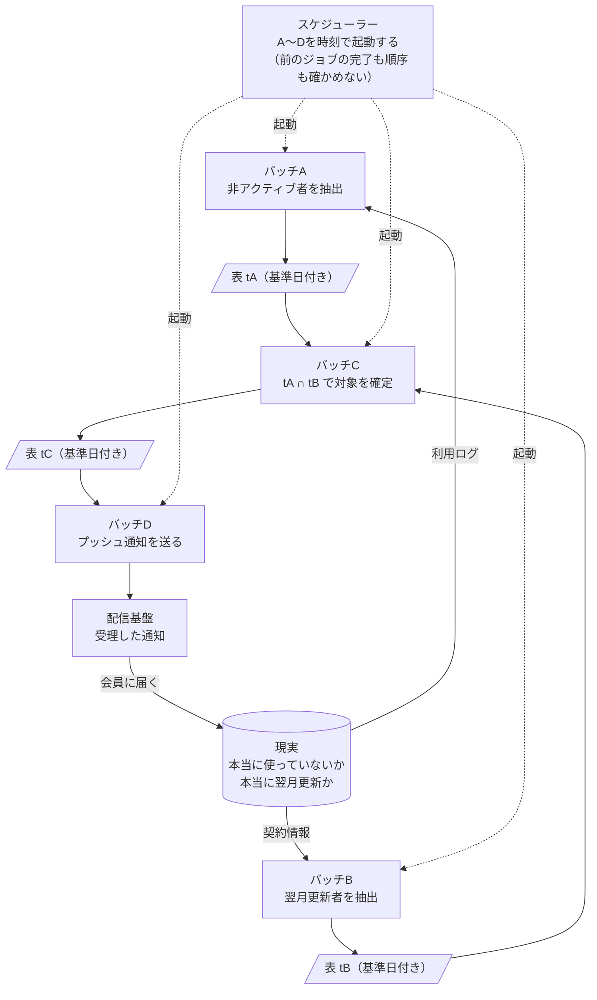

## はじめに

[STAMP/STPA を SRE の視点で解説した記事](https://zenn.dev/maruloop/articles/7ff108e29741b5)に、次のような例が出てきます。有料サブスクリプションで、長く使っていない会員に、契約の自動更新前に退会を案内するプッシュ通知を送る。処理は4つのバッチに分かれています。

この記事では、その例を題材に次のことを試しました。

- アプリを Go で実装する
- 同じ構造を Lean 4 でモデル化する
- 「各バッチは単体では正しい」と「組み合わせると安全制約を破る」を、どちらも Lean の定理として証明する
- Lean が見つけた危険な実行順を、Go の実装で再生して確かめる

STPA のハザードという概念に、Lean で具体的な中身を与えられるか、というのがテーマです。

コードは [kokeshiM0chi/lean-experiments](https://github.com/kokeshiM0chi/lean-experiments) の `renewal-notice/` にあります。

## 題材：契約更新前の退会案内アプリ

アプリは次の4つのバッチでできています。それぞれスケジューラーが時刻で起動します。

1. バッチA：利用ログから、一定期間使っていない会員を抽出する
2. バッチB：契約情報から、翌月に自動更新を迎える有料会員を抽出する
3. バッチC：AとBの積集合を取り、通知対象を確定する
4. バッチD：確定した対象者にプッシュ通知を送る



ポイントは2つです。

- バッチ同士は、前のバッチが書いた表でしかつながっていない
- 起動の順番はスケジューラーの時刻設定に任されていて、前のジョブが終わったかは確かめていない

## SRE はこれをどう捉えるか：STAMP/STPA

詳しくは元記事を読んでいただくとして、ここでは後で Lean に持ち込む部分だけを整理します。

### 部品が壊れていなくても事故は起きる

従来の障害分析は、「どの部品が壊れたか」を探します。STAMP は、事故を「安全制約がシステム全体で守られなかった結果」と捉えます。各部品が仕様どおりに動いていても、組み合わせ方によっては事故が起きます。

今回のバッチも、どれか1つを単体テストしても問題は見つかりません。問題は、バッチ間の前提（実行順、表の鮮度、送信済みかどうか）が崩れたときに起きます。

### Loss・Hazard・安全制約

STPA の最初のステップでは、避けたい損失（Loss）を決めます。次に、損失につながるシステムの状態（Hazard）を決め、その否定を安全制約にします。

元記事の Loss と Hazard をもとに、このモデルでは次のように置きました。H3 は、モデルで扱いやすいように言い換えています。

| Loss | Hazard | 安全制約 |
| --- | --- | --- |
| L1 続けたい会員が不要な退会をする | H1 対象外の会員に案内が送られる | SC1 送信時点で本当に対象の会員にだけ送る |
| L2 重複した案内で不信感を与える | H2 同じ会員に重複して送られる | SC2 送信先に重複がない |
| L3 案内を受けずに更新を迎える | H3 全ジョブが正常終了したのに、対象者が漏れている | SC3 全ジョブが正常終了したなら、対象者全員に送られている |

### 制御構造とプロセスモデル

STPA では、システムを「コントローラーが制御動作を出し、フィードバックを受け取る」構造で描きます。

コントローラーが持っている「世界はこうなっているはずだ」という認識を、プロセスモデルと呼びます。今回の図では、表 tA・tB・tC がプロセスモデルにあたります。バッチは現実を直接見ず、表を通してしか世界を知りません。そのため、表が古ければ、バッチは古い世界に対して正しく動いてしまいます。

### UCA と Loss Scenario

次に、制御動作がどんな状況で危険になるかを洗い出します。これが UCA（Unsafe Control Action）で、たとえば「対象者の抽出が終わる前に通知を始める」がそれにあたります。最後に、UCA がどうして起きるかの筋書き（Loss Scenario）を探します。たとえば「Aが遅れているのに、時刻どおりにCが起動して、前回の結果で積集合を取る」です。

元記事でも、この Loss Scenario の探索がいちばん重い作業として扱われています。実行順や部分失敗の組み合わせを、人が漏れなく考えるのは難しいからです。

## STPA の概念を Lean で書く

### 方針：「証明できない」ではなく「否定を証明する」

最初は「安全性を証明しようとして、証明できなかったところをハザードとみなせばよい」と考えていました。しかし Lean の中では、証明に失敗したことは判定できません。証明できない理由が、命題が偽だからなのか、証明の書き方が悪いだけなのか、区別できないからです。

そこで、次のように言い換えました。

- **ハザード**：安全制約を破る状態に、何らかの実行順で到達できること。つまり `∀ 実行順, 安全` の否定を証明できること
- **Loss Scenario**：その否定を証明するときに使う、具体的な実行順（反例）
- **UCA**：その実行順の中で、安全制約が初めて破れた制御動作と、その直前の状態

こうすると、「部品は正しい（∀ の定理）」と「組み合わせると危険（∃ の定理）」を、同じファイルの中に並べられます。

### STPA・Lean・Go の対応

| STPA の概念 | Lean | Go |
| --- | --- | --- |
| 制御対象プロセス（現実） | `World` | `World` |
| コントローラー | `batchA`〜`batchD` | `BatchA()`〜`BatchD()` |
| 制御動作 | `Action` の `runA`〜`runD`、`crashD k` | `POST /jobs/{A,B,C,D}` |
| 外乱 | `use u`（利用再開）、`breakSource`（ログ故障） | `POST /events/use` など |
| プロセスモデル | 表 `tA` `tB` `tC`（基準日 `asOf` 付き） | `TA` `TB` `TC` |
| 安全制約 | `sc1` `sc2` `sc3` | `SC1()`〜`SC3()` |
| Hazard | `∃ t, sc (run d init t) = false` | `Hazards()` |
| Loss Scenario | 反例の実行順 `t` | テストで再生 |
| UCA | `firstUCA` | なし |

### モデル

状態には、現実（`World`）と各バッチの認識（表）を分けて持たせます。STPA の「プロセスモデルが現実とずれる」を、そのまま型で表すためです。以下のコードは、説明に必要な部分だけを抜き出して簡略化しています。

```lean
structure World where
  users    : List User
  inactive : List User   -- 本当に使っていない会員
  renewing : List User   -- 本当に翌月更新の会員
  logOk    : Bool := true

structure Table where
  asOf : Nat             -- 基準日
  rows : List User

structure State where
  today : Nat
  world : World
  tA tB tC : Table
  sent  : List (User × Bool)  -- (宛先, 送信時点で本当に対象だったか)
  rA rB rC rD : JobResult      -- スケジューラーから見えるジョブの結果
```

`sent` の2つ目の値は、送った瞬間に本当に対象者だったかという「神の視点」の記録です。バッチ自身はこれを知りません。

スケジューラーは順序を保証しないので、どの順に何を実行してもよいものとして扱います。外乱もここに入れます。

```lean
inductive Action where
  | runA | runB | runC | runD
  | crashD (k : Nat)   -- D が k 件送ったところで異常終了
  | use (u : User)     -- 会員が利用を再開する
  | breakSource       -- 利用ログのソースが壊れて0件を返す

def run (d : Design) : State → List Action → State
  | s, []     => s
  | s, a :: t => run d (step d s a) t
```

安全制約は、状態を受け取って Bool を返す関数です。

```lean
def sc1 (s : State) : Bool := s.sent.all (fun p => p.2)
def sc2 (s : State) : Bool := nodupB (sentUsers s)
def sc3 (s : State) : Bool :=
  !allOk s || s.world.users.all (fun u => !s.world.isTarget u || (sentUsers s).contains u)
```

初期状態は、前回のサイクル（day 0）の表が残ったまま、今日（day 1）のサイクルが始まった時点です。会員は3人で、本当の通知対象は会員1と2です。

## 各バッチは単体では正しい

まず、各バッチが単体の仕様どおりに動くことを、すべての入力について証明します。たとえばバッチCは、tA と tB の積集合をそのまま返します。

```lean
theorem batchC_spec (s : State) (u : User) :
    u ∈ (batchC .naive s).tC.rows ↔ u ∈ s.tA.rows ∧ s.tB.rows.contains u = true := by
  simp [batchC, intersect, List.mem_filter]
```

A・B・D についても同じ形の定理（`batchA_spec`、`batchB_spec`、`batchD_spec`）を証明しています。単体テストで確かめていることを、すべての入力について保証したものです。

## それでも組み合わせると危険

次に、同じバッチを組み合わせたシステムが安全ではないことを証明します。全称命題の否定を、反例を1つ示して証明します。

```lean
theorem naive_unsafe :
    ¬ ∀ t : List Action, safeAll (run .naive init t) = true := by
  intro h
  exact absurd (h traceRetry) (by decide)
```

どの実行順が反例になるかは、人が考えなくても探せます。長さ5以下のすべての実行順（7種類の動作の組み合わせ）を列挙し、安全制約を破る最短のものを探すと、次の結果になりました。

| ハザード | 最短の反例 | 何が起きたか |
| --- | --- | --- |
| H1 対象外への送信 | `D` | 前回分の表 tC（会員0）のまま、D が送ってしまう |
| H2 重複送信 | `D, D` | 送信済みかを確かめずに、D をもう一度実行する |
| H3 正常終了なのに漏れ | `A, B, D, C` | D が C より先に古い表で送り、最後に C が終わって全ジョブが正常に見える |

私が最初に手で考えたシナリオは、4〜5ステップのものでした。自動で探すと、`D` を1回実行するだけで事故になる、というより短い反例が見つかりました。実行順の組み合わせを漏れなく調べるのは、人より機械のほうが得意です。

この反例の実行順が Loss Scenario にあたります。安全制約が初めて破れた操作と、その直前の状態も自動で取り出しています（`firstUCA`）。ただし、これは「破れた瞬間の操作」であって、根本原因とは限りません。H3 では C が指されますが、本当の原因は「D が C より先に走ったこと」です。

## 対策を入れて検証する

STPA で導いた安全要求を、対策版（`safe`）として入れました。

- バッチC は、tA と tB の基準日が今日でなければ失敗として終わる
- バッチD は、tC の基準日が今日でなければ失敗として終わる
- バッチD は、配信基盤の受理記録（フィードバック）を見て送信済みを除き、送る直前に対象者かを確かめ直す

対策版では、H1 が起きないことを、実行順の長さに関係なく帰納法で証明しました。

```lean
theorem safe_no_H1 (t : List Action) (s : State) (h : SentOk s) :
    SentOk (run .safe s t) := by
  induction t generalizing s with
  | nil => exact h
  | cons a t ih => exact ih _ (step_safe_sentOk s a h)
```

H2 と H3 は、ログ故障を除く長さ5以下の全実行順（9,331本）で、安全制約が成り立つことを確かめました（`safe_bounded`）。こちらは有界検査なので、長さ6以上については何も言っていません。

さらに、ログ故障という外乱を戻すと、対策版でも H3 が起きることを証明しました（`safe_residual_H3`）。利用ログのソースが壊れると、バッチA は0件のまま正常終了し、誰にも通知が届きません。これが「抽出件数の完全性を確かめる」という次の安全要求になります。

### 未証明の主張をハザードの候補として残す

「対策版では、どんな長さの実行順でも H2 が起きない」は、まだ証明できていません。証明には、「tC に重複がない」という不変条件を示す必要があります。この主張は `sorry` のまま残し、Lean Atlas の属性で未着手の印を付けています（属性は一部省略）。

```lean
@[proof_progress stub]
theorem safe_no_H2 (t : List Action) : sc2 (run .safe init t) = true := by
  sorry
```

証明できていない安全主張は、まだ見つかっていないハザードが潜んでいるかもしれない場所です。ハザードの候補として扱い、見える場所に置いておきます。

## 証明状況のまとめ

| 主張 | 対策なし（naive） | 対策版（safe） |
| --- | --- | --- |
| 各バッチの単体仕様 | ✅ 証明済み（`batchA_spec`〜`batchD_spec`） | ⬜ 定理なし |
| H1 対象外への送信 | 🟥 起きることを証明（`H1_stale`、`H1_toctou`） | ✅ 任意長で起きない（`safe_no_H1`） |
| H2 重複送信 | 🟥 起きることを証明（`H2_retry`） | 🟨 長さ5以下では起きない（`safe_bounded`）。任意長は未証明（`safe_no_H2`、`sorry`） |
| H3 正常終了なのに漏れ | 🟥 起きることを証明（`H3_stale`、`H3_silent`） | 🟥 ログ故障で残る（`safe_residual_H3`）。故障なしなら長さ5以下では起きない |
| システム全体 | 🟥 安全ではない（`naive_unsafe`） | 🟨 H1 は任意長、H2・H3 は有界検査のみ |

✅ 安全を証明　🟥 ハザードの存在を証明　🟨 有界検査のみ・一部未証明　⬜ 定理なし

🟥 も「証明済み」です。安全制約を破る実行順が存在することを、定理として示しています。

定理どうしの依存関係と証明の進み具合は、[Lean Atlas](https://github.com/NyxFoundation/lean-atlas) で可視化しました。主要な定理に、STPA 上の役割（「Loss Scenario → H1」など）を注記として付けています。下の画像は `naive_unsafe` が依存している定義をたどったものです。


## 実装（Go）とつなぐ

Lean で証明したのはモデルについてです。モデルと実装がずれていれば、意味がありません。そこで、Lean が見つけた反例を JSON に書き出し、Go のテストで同じ実行順を再生しています。

```go
for _, ce := range ces {
	got := replay(t, Design(ce.Design), ce.Trace)
	if !slices.Contains(got, ce.Hazard) {
		t.Errorf("Leanの反例 %s/%s %v が実装で再現しない（got %v）。モデルと実装が乖離しています",
			ce.Design, ce.Hazard, ce.Trace, got)
	}
}
```

現時点では、Lean の反例はすべて Go の実装でも再現しています。HTTP の API からジョブを1つずつ実行して、同じ事故を手で起こすこともできます。

```sh
curl -X POST 'localhost:8080/reset?design=naive'
curl -X POST localhost:8080/jobs/D   # 応答の "hazards" に ["H1"] が出る
```

## この方法でできること、できないこと

できたこと：

- 実行順の組み合わせを漏れなく調べ、人より短い Loss Scenario を見つけられた
- 「部品は正しい」と「組み合わせると危険」を、同じ形式の定理として並べられた
- 対策の効果を、任意長（帰納法）と有界検査で区別して示し、残るハザードも見つけられた
- 証明できていない安全主張を `sorry` として可視化できた

限界：

- 見つかるのは、モデルに入れた動作の「未知の組み合わせ」だけです。「配信基盤が受理したのに届かない」のような、モデルに入れていない種類の故障は見つかりません
- Loss と Hazard の定義が妥当かは、人が判断します。Lean は定義の中身の正しさまでは検証しません
- Go の実装そのものが安全であることは証明していません。実装との一致は、反例を再生する片方向の確認だけです
- 実行順の探索だけなら、TLA+ や Alloy のほうが道具として成熟しています。Lean の強みは、対策について長さに関係なく成り立つことを証明できる点と、未証明の主張が `sorry` として残る点です

## 手順としてまとめる

今回の流れを、STPA の手順に沿ってまとめると次のようになります。

1. Loss と Hazard を決め、安全制約を `State → Bool` の関数として書く。状態には、現実と各コントローラーの認識を分けて持たせる
2. 制御構造から、制御動作を `Action` として列挙する。スケジューラーは順序を保証しないものとして扱う
3. STPA のガイドワードを `Action` に変換する。順序・タイミングはスケジューラーの自由度、「提供されない」は省略、「余分に提供」は重複実行、フィードバックの欠落はクラッシュやタイムアウトにあたる
4. 各コントローラーの単体仕様を、∀ の定理として証明する
5. 有界の全探索で反例を探す。見つかった実行順を Loss Scenario として、∃ の定理（または全称命題の否定）で残す
6. 対策を入れ、安全性を帰納法で証明する。証明できないものは `sorry` のまま残し、ハザードの候補として追跡する
7. 反例を実装のテストで再生し、モデルと実装のずれを確かめる

3 の変換規則をきちんと決めれば、「どの外乱をモデルに入れるか」という人に依存する部分を、ある程度体系化できると考えています。

## 動かし方

Lean 4（v4.36.0）、Go、pnpm 10 で動作を確認しています。

```sh
git clone https://github.com/kokeshiM0chi/lean-experiments
cd lean-experiments/renewal-notice/lean
lake build                                    # 定理をすべて検査する
lake exe explore > out/counterexamples.json   # 反例を探す
cd ../go && go test ./... -count=1 -v          # 反例を Go の実装で再生する
go run ./cmd/server                           # HTTP API（:8080）
```

## まとめ

- STAMP/STPA の「部品は正常でも、相互作用で事故が起きる」という考え方は、Lean の定理として書ける
- ハザードは「安全性が証明できないこと」ではなく「安全制約を破る実行順が存在することの証明」として扱うと、反例がそのまま Loss Scenario になる
- 有効性をきちんと示すには、モデルを書いた人とは別の人が実装にバグを仕込み、この方法で見つかるかを比べる実験が必要

題材と STPA の考え方は、[元記事](https://zenn.dev/maruloop/articles/7ff108e29741b5)によるものです。ありがとうございました。
