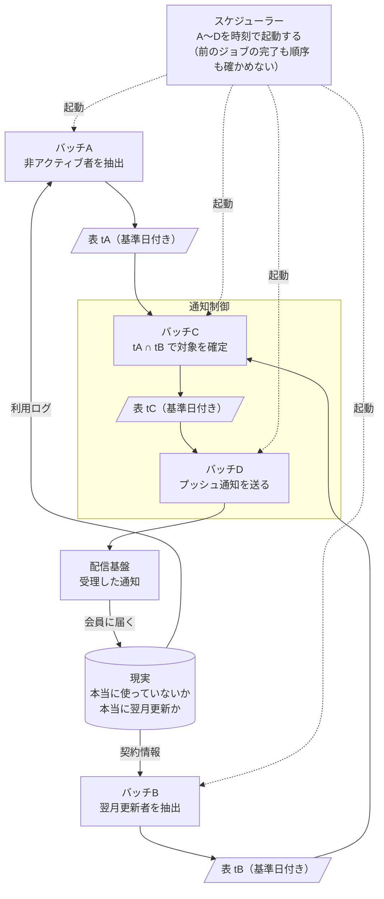
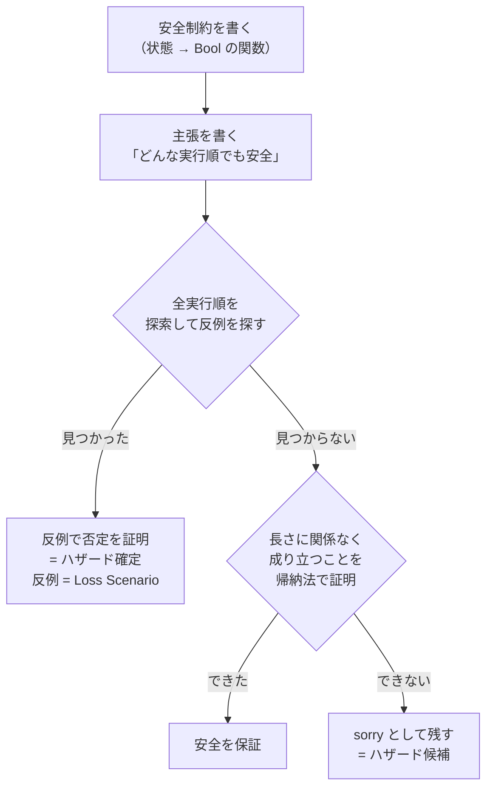
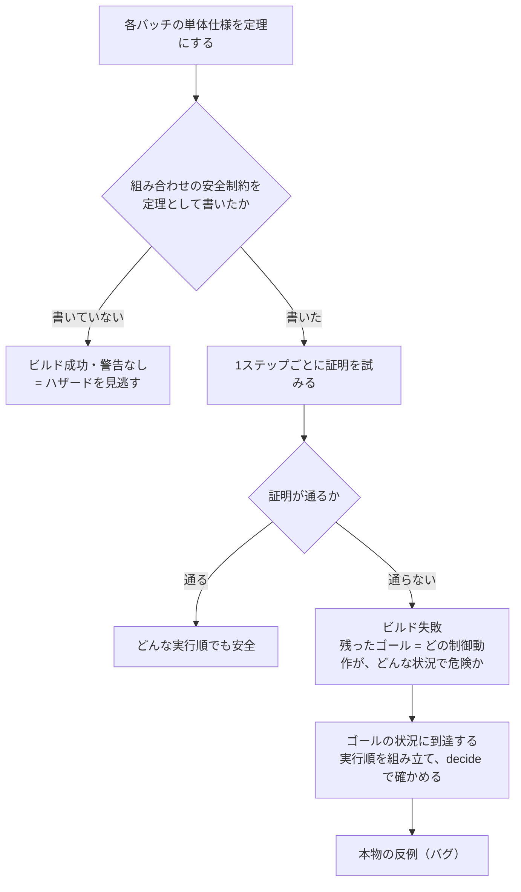
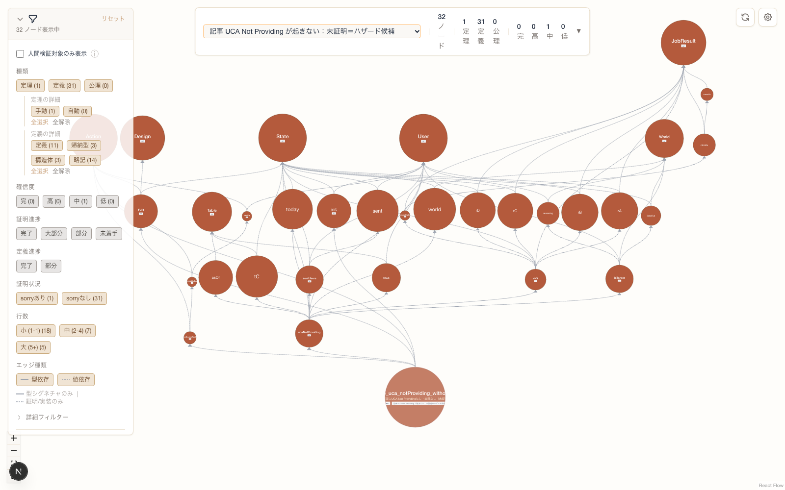
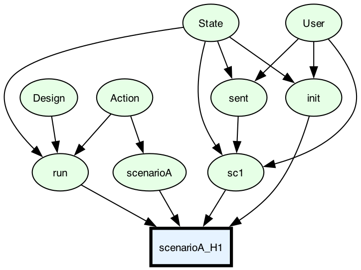

## はじめに

[STAMP/STPA を SRE の視点で解説した記事](https://zenn.dev/maruloop/articles/7ff108e29741b5)（以下、元記事）に、次の例が出てきます。有料サブスクリプションで、長く使っていない会員に、契約の自動更新前に退会を案内するプッシュ通知を送る。処理は4つのバッチに分かれています。

この記事には目的が2つあります。

1. 元記事のアプリ仕様と STPA の分析（Loss、Hazard、UCA、Loss Scenario）を Lean 4 で形式化し、「ハザード」に定理として検査できる中身を与える。特に、組み合わせの安全制約を定理として書くと、ハザードがビルドの失敗として見つかり、そこから反例（バグ）を組み立てられることを示す
2. Lean を自分たちのアプリに導入する手順を、実例として共有する。プロジェクトの作り方、ビルドで何が分かるか、[Lean Atlas](https://github.com/NyxFoundation/lean-atlas) で何を可視化できるか、CI への組み込み方まで

コードはすべて [kokeshiM0chi/lean-experiments](https://github.com/kokeshiM0chi/lean-experiments) の [`renewal-notice/`](https://github.com/kokeshiM0chi/lean-experiments/tree/main/renewal-notice) にあります。記事中のコードは要点だけを抜き出したもので、各節に元のファイルへのリンクを付けています。各定理で何を言いたいのか、証明の各行が何をしているのかは、[ソースコード解説（`renewal-notice/docs/`）](https://github.com/kokeshiM0chi/lean-experiments/tree/main/renewal-notice/docs)に詳しく書いています。

```text
renewal-notice/
├── go/      アプリ本体（Go）。バッチ A〜D、HTTP API、テスト
└── lean/    アプリのモデルと定理（Lean 4）。ビルド時の検査
```

## 題材：契約更新前の退会案内アプリ

元記事のアプリは、次の4つのバッチでできています。それぞれスケジューラーが時刻で起動します。

1. バッチA：利用ログから、一定期間使っていない会員を抽出する
2. バッチB：契約情報から、翌月に自動更新を迎える有料会員を抽出する
3. バッチC：AとBの積集合を取り、通知対象を確定する
4. バッチD：確定した対象者にプッシュ通知を送る



元記事の制御構造では、コントローラーは「非アクティブユーザー抽出」「翌月更新ユーザー抽出」「通知制御」の3つです。このアプリでは、通知制御をバッチCとDに分けて実装しています。

Go の実装は [`go/batch/system.go`](https://github.com/kokeshiM0chi/lean-experiments/blob/main/renewal-notice/go/batch/system.go) にあります。HTTP API からジョブを1つずつ実行できます。

ポイントは2つです。

- バッチ同士は、前のバッチが書いた表でしかつながっていない
- 起動の順番はスケジューラーの時刻設定に任されていて、前のジョブが終わったかは確かめていない

## SRE はこれをどう捉えるか：STAMP/STPA

詳しくは元記事を読んでいただくとして、ここでは Lean に持ち込む部分だけを整理します。

従来の障害分析は、「どの部品が壊れたか」を探します。STAMP は、事故を「安全制約がシステム全体で守られなかった結果」と捉えます。各部品が仕様どおりに動いていても、組み合わせ方によっては事故が起きます。今回のバッチも、どれか1つを単体テストしても問題は見つかりません。問題は、バッチ間の前提（実行順、表の鮮度、送信済みかどうか）が崩れたときに起きます。

| STPA のステップ | 何をするか | 今回の例 |
| --- | --- | --- |
| 1. Loss・Hazard・安全制約 | 避けたい損失と、損失につながる状態を決める | 「続けたい会員が不要な退会をする」など |
| 2. 制御構造 | コントローラー、制御動作、フィードバックを描く | 上の図 |
| 3. UCA | 制御動作がどんな状況で危険になるかを洗い出す | 「抽出の完了前に通知を始める」など |
| 4. Loss Scenario | UCA やハザードがどうして起きるかの筋書きを探す | 「Aが遅れているのに、時刻どおりにCが起動する」など |

コントローラーが持っている「世界はこうなっているはずだ」という認識を、プロセスモデルと呼びます。今回は表 tA・tB・tC がプロセスモデルにあたります。バッチは現実を直接見ず、表を通してしか世界を知りません。そのため、表が古ければ、バッチは古い世界に対して「正しく」動いてしまいます。

元記事でも、Loss Scenario の探索がいちばん重い作業として扱われています。実行順や部分失敗の組み合わせを、人が漏れなく考えるのは難しいからです。

## Lean に馴染みがない人向けに：定理と反例

本題に入る前に、この記事で使う Lean の考え方を説明します。

**定理は「すべての入力についてのテスト」です。** 普通のテストは、いくつかの入力を試して「この場合は大丈夫」と確かめます。Lean の定理は「すべての入力で大丈夫」と主張し、その証明を Lean が機械的に検査します。

たとえば「どんな実行順でも安全」という主張は、Lean では次のように書きます。

```lean
∀ t : List Action, safeAll (run .naive init t) = true
```

| 記号 | 読み方 |
| --- | --- |
| `∀ t : List Action` | どんな実行順 t についても（`List Action` は「Aを実行、次にDを実行、……」という操作の並び） |
| `run .naive init t` | 初期状態から、t の順にバッチや外乱を起こした結果が |
| `safeAll (...) = true` | 安全制約をすべて満たす |

**反例が1つあれば、その主張は偽です。** 「すべての t で安全」は、安全でない t が1つ見つかれば崩れます。

**見つけた反例を Lean に検査させると、「安全ではない」が定理になります。** `¬` は「〜ではない」、`by decide` は「実際に計算して確かめよ」という指示です。Lean が実行順どおりにモデルを動かし、安全制約が破れることを確認します。

**Lean は、証明に失敗した理由を区別できません。** 失敗したのが主張が間違っているからなのか、証明の書き方が悪いだけなのか、分からないということです。そこで、「証明できない」をそのままハザードとはみなさず、次のように扱いを分けました。



`sorry` は「ここは証明を省略した」という印です。ビルドすると警告が出るので、未証明の主張を見落としません。

## 導入手順：Lean プロジェクトを作ってビルドする

ここからは、手元で同じものを動かす手順です。自分たちのアプリに導入するときも、同じ流れになります。

### 1. Lean を入れる

Lean のバージョン管理ツール elan を入れます。`lake`（Lean のビルドツール）も一緒に入ります。

```sh
curl https://raw.githubusercontent.com/leanprover/elan/master/elan-init.sh -sSf | sh
```

プロジェクトで使う Lean のバージョンは、各プロジェクトの `lean-toolchain` ファイルで決まります。elan が自動でそのバージョンを取ってくるので、プロジェクトごとに手で入れる必要はありません。

### 2. プロジェクトを作る

新しく作るなら `lake new <名前>` で雛形ができます。今回のプロジェクトの設定は次の2つのファイルです。

[`lean/lean-toolchain`](https://github.com/kokeshiM0chi/lean-experiments/blob/main/renewal-notice/lean/lean-toolchain)：

```text
leanprover/lean4:v4.36.0
```

[`lean/lakefile.toml`](https://github.com/kokeshiM0chi/lean-experiments/blob/main/renewal-notice/lean/lakefile.toml)：

```toml
name = "renewal-notice"
defaultTargets = ["RenewalNotice", "explore"]

# 定理を書くライブラリ
[[lean_lib]]
name = "RenewalNotice"

# 反例を JSON に書き出す実行ファイル（Go のテストが読む）
[[lean_exe]]
name = "explore"
root = "Main"

# 証明状況の注記と可視化
[[require]]
name = "lean-atlas"
git = "https://github.com/kokeshiM0chi/lean-atlas"
rev = "main"
```

lean-atlas は Nyx Foundation の [lean-atlas](https://github.com/NyxFoundation/lean-atlas) を fork したものを指定しています。Mathlib（Lean の数学ライブラリ）は使っていないので、初回のビルドも数分で終わります。

### 3. ファイルを書く順番

[`lean/RenewalNotice/`](https://github.com/kokeshiM0chi/lean-experiments/tree/main/renewal-notice/lean/RenewalNotice) の下に、STPA の手順に沿ってファイルを分けています。自分たちのアプリに当てはめるときも、上から順に書いていけば同じ構成になります。

| 順番 | ファイル | 書くもの | 自分のアプリでは |
| --- | --- | --- | --- |
| 1 | [`Model.lean`](https://github.com/kokeshiM0chi/lean-experiments/blob/main/renewal-notice/lean/RenewalNotice/Model.lean) | 状態、コントローラー（バッチ）、スケジューラー、外乱 | 実装の主要な関数を、副作用のない関数として写す |
| 2 | [`Safety.lean`](https://github.com/kokeshiM0chi/lean-experiments/blob/main/renewal-notice/lean/RenewalNotice/Safety.lean) | Loss・Hazard と安全制約 | STPA で決めた安全制約を `State → Bool` で書く |
| 3 | [`Uca.lean`](https://github.com/kokeshiM0chi/lean-experiments/blob/main/renewal-notice/lean/RenewalNotice/Uca.lean) | UCA | UCA 表の各行を「状態と制御動作の述語」で書く |
| 4 | [`ModelCheck.lean`](https://github.com/kokeshiM0chi/lean-experiments/blob/main/renewal-notice/lean/RenewalNotice/ModelCheck.lean) | 全実行順の列挙と反例探索 | ほぼそのまま使える。`alphabet`（起こりうる動作）だけ差し替える |
| 5 | [`Scenarios.lean`](https://github.com/kokeshiM0chi/lean-experiments/blob/main/renewal-notice/lean/RenewalNotice/Scenarios.lean) | Loss Scenario の実行順 | STPA で挙げたシナリオを実行順として書く |
| 6 | [`Spec.lean`](https://github.com/kokeshiM0chi/lean-experiments/blob/main/renewal-notice/lean/RenewalNotice/Spec.lean) | 各コントローラーの単体仕様（定理） | 単体テストで確かめていることを定理にする |
| 7 | [`Hazards.lean`](https://github.com/kokeshiM0chi/lean-experiments/blob/main/renewal-notice/lean/RenewalNotice/Hazards.lean) | ハザードと UCA が起きることの証明 | シナリオごとに「安全制約が破れる」を定理にする |
| 8 | [`SafeDesign.lean`](https://github.com/kokeshiM0chi/lean-experiments/blob/main/renewal-notice/lean/RenewalNotice/SafeDesign.lean) | 対策版の安全性（証明・有界検査・未証明） | 対策を入れたモデルで、安全制約が守られることを示す |
| 9 | [`Audit.lean`](https://github.com/kokeshiM0chi/lean-experiments/blob/main/renewal-notice/lean/RenewalNotice/Audit.lean) | ビルド時の検査 | ほぼそのまま使える。名前空間だけ差し替える |

### 4. ビルドする

```sh
cd renewal-notice/lean
lake build
```

`lake build` は、定理の証明を検査するだけでなく、[`Audit.lean`](https://github.com/kokeshiM0chi/lean-experiments/blob/main/renewal-notice/lean/RenewalNotice/Audit.lean) の中で次のことを行い、結果をビルドのメッセージとして出します。

- 長さ5以下の全実行順を探索し、安全制約を破るもの（ハザード）と、UCA に当たる制御動作を含むものを警告として出す
- 未証明の主張（`sorry`）を警告として出す
- 証明状況の注記と、実際の証明が食い違っていればエラーにする（後述）

実際の出力です。

```text
warning: ハザード検出 [naive] H1: 通知対象外のユーザーが、退会案内の配信対象に含まれている (→L1)
  Loss Scenario: ["D"] （安全制約を初めて破った制御動作: D）
warning: ハザード検出 [naive] H2: 同じユーザー・契約更新期に対する通知が、重複して発行可能な状態にある (→L2)
  Loss Scenario: ["D", "D"] （安全制約を初めて破った制御動作: D）
warning: ハザード検出 [naive] H3: 案内が必要な対象者について、通知期限までに送信を開始できない状態にある (→L3)
  Loss Scenario: ["A", "B", "D", "C"] （安全制約を初めて破った制御動作: C）
warning: UCA検出 [naive] Not Providing: 対象者の抽出が完了しているのに、期限までに送信を開始しない
  実行順: ["A", "B", "D", "C"]
warning: UCA検出 [naive] Providing: 通知済みか不明なユーザーに対して、新しい送信を開始する
  実行順: ["D", "D"]
warning: UCA検出 [naive] Timing / Order: 対象者抽出の完了前に通知を開始する
  実行順: ["D"]
info: [safe] H1: 長さ5以下の反例なし
info: [safe] H2: 長さ5以下の反例なし
warning: ハザード検出 [safe] H3: 案内が必要な対象者について、通知期限までに送信を開始できない状態にある (→L3)
  Loss Scenario: ["B", "breakSource", "A", "C", "D"] （安全制約を初めて破った制御動作: D）
info: [safe] UCA Not Providing: 長さ5以下では起きない
info: [safe] UCA Providing: 長さ5以下では起きない
info: [safe] UCA Timing / Order: 長さ5以下では起きない
warning: 未証明の主張（ハザード候補）: RenewalNotice.safe_no_H2（注記: stub）
warning: 未証明の主張（ハザード候補）: RenewalNotice.safe_no_H3_without_fault（注記: stub）
warning: 未証明の主張（ハザード候補）: RenewalNotice.safe_no_uca_notProviding_without_fault（注記: stub）
info: 証明状況: 証明済み 33 件（うち native_decide に依存 1 件）、未証明 3 件
Build completed successfully (55 jobs).
```

`naive` は対策なし版、`safe` は対策版です。それぞれの中身は、この後の節で説明します。

ビルド時に探索を走らせる仕組みは、`#eval` で Lean のプログラムを実行し、`logWarning` で警告を出しているだけです（以下は簡略化したもの）。

```lean
def scanHazards : CommandElabM Unit := do
  for d in [Design.naive, Design.safe] do
    for h in [Hazard.H1, Hazard.H2, Hazard.H3] do
      match counterexample d h alphabet searchBound with
      | some t => logWarning m!"ハザード検出 [{d.name}] {h.name}: {h.describe}\n  Loss Scenario: {traceStr t}"
      | none   => logInfo m!"[{d.name}] {h.name}: 長さ{searchBound}以下の反例なし"

#eval RenewalNotice.Audit.scanHazards
```

## 元記事の分析を Lean の定義にする

### モデル（[`Model.lean`](https://github.com/kokeshiM0chi/lean-experiments/blob/main/renewal-notice/lean/RenewalNotice/Model.lean)）

状態には、現実（`World`）と各バッチの認識（表）を分けて持たせます。STPA の「プロセスモデルが現実とずれる」を、そのまま型で表すためです。以下は要点だけを抜き出して簡略化したものです。

```lean
structure World where
  users    : List User
  inactive : List User   -- 本当に使っていない会員
  renewing : List User   -- 本当に翌月更新の会員
  logOk    : Bool := true

structure Table where
  asOf : Nat             -- 基準日
  rows : List User

structure State where
  today : Nat
  world : World
  tA tB tC : Table
  sent  : List (User × Bool)  -- (宛先, 送信時点で本当に対象だったか)
  rA rB rC rD : JobResult      -- スケジューラーから見えるジョブの結果
  tCInputsAsOf : Nat           -- tC を作るのに実際に使った tA・tB の基準日
```

`sent` の2つ目の値と `tCInputsAsOf` は、観測者だけが知る真実です。バッチ自身はこれを見ません。たとえば対策なしのバッチCは、古い tA で積集合を取っても、表には今日の日付を付けてしまいます。表の日付だけでは「今日の抽出が終わる前に作った表か」が分からないので、実際の入力の日付を別に記録しています。

バッチは、状態を受け取って新しい状態を返す関数です。Go の実装と1対1に対応させています。

```lean
def batchC : Design → State → State
  | .naive, s => { s with tC := intersect s.tA s.tB s.today, rC := .ok,
                          tCInputsAsOf := min s.tA.asOf s.tB.asOf }
  | .safe,  s =>
    if s.tA.asOf = s.today ∧ s.tB.asOf = s.today then
      { s with tC := intersect s.tA s.tB s.today, rC := .ok,
               tCInputsAsOf := min s.tA.asOf s.tB.asOf }
    else
      { s with rC := .failed }
```

スケジューラーは順序を保証しないので、どの順に何を実行してもよいものとして扱います。外乱もここに入れます。

```lean
inductive Action where
  | runA | runB | runC | runD
  | crashD (k : Nat)   -- 配信基盤が k 件を受理した後で、D が失敗として終わる
  | use (u : User)     -- 会員が利用を再開する
  | breakSource       -- 利用ログのソースが壊れて0件を返す
```

`crashD k` は、元記事のシナリオB（途中で異常終了）とシナリオC（タイムアウトで結果が分からない）の両方を表します。どちらも、配信基盤では受理済みなのに、D とスケジューラーからは失敗に見える状況です。

初期状態は、前回のサイクル（day 0）の表が残ったまま、今日（day 1）のサイクルが始まった時点です。

| 会員 | 翌月更新 | 今の利用状況 | 通知対象か |
| --- | --- | --- | --- |
| 0 | する | 最近利用を再開した（前回の抽出では非アクティブだった） | 対象外 |
| 1 | する | 使っていない | 対象 |
| 2 | する | 使っていない | 対象 |

前回の表 tA には会員0が残っているので、古い tA を使うと会員0に案内が届いてしまいます。

### Loss・Hazard・安全制約（[`Safety.lean`](https://github.com/kokeshiM0chi/lean-experiments/blob/main/renewal-notice/lean/RenewalNotice/Safety.lean)）

元記事の表を、そのまま安全制約（状態を受け取って Bool を返す関数）にします。

| 元記事の Loss | 元記事の Hazard | 安全制約（Lean） |
| --- | --- | --- |
| L1 誤った退会案内によって、継続を望むユーザーが不要な退会をしてしまう | H1 通知対象外のユーザーが、退会案内の配信対象に含まれている | `sc1` 送った時点で本当に対象のユーザーにだけ送っている |
| L2 重複する退会案内によって、ユーザーに不信感を与える | H2 同じユーザー・契約更新期に対する通知が、重複して発行可能な状態にある | `sc2` 同じユーザーに重複して送っていない |
| L3 通知対象のユーザーが案内を受けられず、意図しない契約更新を迎える | H3 案内が必要な対象者について、通知期限までに送信を開始できない状態にある | `sc3` 全ジョブが正常終了した時点で、対象者全員に送っている |

元記事が安全制約として明示しているのは `sc2`（重複する通知指示を発行してはならない）だけです。`sc1` と `sc3` は、STPA の手順どおり Hazard を否定して導きました。

H3 の「通知期限」は、このモデルでは「全ジョブが正常終了した時点」と読み替えています。モデルに時刻の進みがないためです。ジョブが失敗していれば監視で気づけるので、ここで扱うのは「正常終了に見えるのに届いていない」場合です。

```lean
def sc1 (s : State) : Bool := s.sent.all (fun p => p.2)
def sc2 (s : State) : Bool := nodupB (sentUsers s)
def sc3 (s : State) : Bool :=
  !allOk s || s.world.users.all (fun u => !s.world.isTarget u || (sentUsers s).contains u)
```

### UCA（[`Uca.lean`](https://github.com/kokeshiM0chi/lean-experiments/blob/main/renewal-notice/lean/RenewalNotice/Uca.lean)）

元記事の UCA 表は、通知制御の制御動作「プッシュ通知の配信指示」を対象にしています。これを「どんな状況（状態 `s`）で、どの制御動作（`a`）を出すと危険か」という述語にしました。

| 分類 | 元記事の UCA | Lean |
| --- | --- | --- |
| Not Providing | 対象者の抽出が完了しているのに、期限までに送信を開始しない | `ucaNotProviding`：全ジョブ正常終了の時点で、今日抽出した対象者の中に送られていない人がいる |
| Providing | 通知済みか不明なユーザーに対して、新しい送信を開始する | `ucaProviding`：配信基盤が受理済み（タイムアウトで結果不明のものを含む）の人に、また送る |
| Timing / Order | 対象者抽出の完了前に通知を開始する | `ucaTiming`：今日の A・B の結果から作られていない通知対象で、送信を始める |
| Duration | N/A | なし |

```lean
def ucaTiming (d : Design) (s : State) (a : Action) : Bool :=
  (s.tCInputsAsOf != s.today) && !(newSends d s a).isEmpty

def ucaProviding (d : Design) (s : State) (a : Action) : Bool :=
  (newSends d s a).any (fun u => (sentUsers s).contains u)
```

`newSends d s a` は、制御動作 `a` によって配信基盤が新たに受理した宛先です。

## 各バッチは単体では正しい（[`Spec.lean`](https://github.com/kokeshiM0chi/lean-experiments/blob/main/renewal-notice/lean/RenewalNotice/Spec.lean)）

まず、各バッチが単体の仕様どおりに動くことを、すべての入力について証明します。対策なし版（naive）と対策版（safe）の両方です。A と B は両方の設計で同じ定義なので、1つの定理で両方を覆います。

```lean
theorem batchC_naive_spec (s : State) (u : User) :
    (u ∈ (batchC .naive s).tC.rows ↔ u ∈ s.tA.rows ∧ s.tB.rows.contains u = true) ∧
    (batchC .naive s).rC = .ok := by
  simp [batchC, intersect, List.mem_filter]
```

| バッチ | naive の単体仕様 | safe の単体仕様 |
| --- | --- | --- |
| A | `batchA_spec`（両設計共通） | 同左 |
| B | `batchB_spec`（両設計共通） | 同左 |
| C | `batchC_naive_spec` | `batchC_safe_spec_fresh`、`batchC_safe_spec_stale` |
| D | `batchD_naive_spec` | `batchD_safe_spec_fresh`、`batchD_safe_spec_stale`、`pending_not_sent`、`batchDSafe_sentOk` |

単体テストで確かめていることを、すべての入力について保証したものです。

## 組み合わせの安全制約を定理にすると、ビルドが失敗する（[`Detect/`](https://github.com/kokeshiM0chi/lean-experiments/tree/main/renewal-notice/lean/Detect)）

ここがこの記事の中心です。**組み合わせに対する安全制約を定理として書くと、ハザードはビルドの失敗として見つかります。** しかも、実行順を1本も列挙せずに見つかります。逆に、**安全制約を書かなければ、ビルドは成功し、何も見つかりません。**

この2つを比べるために、説明用のビルド対象を3つ用意しました（通常の `lake build` には含めていません）。

| ビルド対象 | 中身 | 結果 |
| --- | --- | --- |
| `DetectWithoutConstraint` | 各バッチの単体仕様だけ | ビルド成功。警告もなし |
| `DetectWithConstraint` | 組み合わせの安全制約を定理として書く | ビルド失敗。失敗箇所がハザードを指す |
| `DetectCounterexample` | 失敗箇所から組み立てた反例を確かめる | ビルド成功 |



### 安全制約を書かない場合

各バッチの単体仕様の定理（前節）をまとめただけのファイルをビルドすると、成功し、警告も出ません。

```text
$ lake build DetectWithoutConstraint
✔ [39/41] Built Detect.WithoutConstraint (15s)
Build completed successfully (41 jobs).
```

Lean は書かれた主張しか検査しないので、組み合わせについて何も主張していなければ、何も言いません。単体テストがすべて通っても、組み合わせの事故を見つけられないのと同じです。

### 安全制約を定理として書く場合

「対策なし版でも、どんな実行順でも、対象外の会員に送らない（SC1）」を定理として書き、証明を試みます。証明の方針は帰納法です。

1. どの制御動作を1回実行しても、安全制約は保たれる（1ステップの補題）
2. それを繰り返し使えば、どんな長さの実行順でも保たれる

この方法は実行順を列挙しません。「すべての状態」と「制御動作の種類（7通り）」を記号的に扱うので、長さの上限もありません。

```lean
theorem naive_D_preserves_sc1 (k : Option Nat) (s : State) (h : SentOk s) :
    SentOk (batchDNaive k s) := by
  intro p hp
  simp only [batchDNaive, List.mem_append, record, List.mem_map] at hp
  rcases hp with hp | ⟨u, hu, rfl⟩
  · exact h p hp
  · skip

theorem naive_step_preserves_sc1 (s : State) (a : Action) (h : SentOk s) :
    SentOk (step .naive s a) := by
  cases a with
  | runA        => exact h
  | runB        => exact h
  | runC        => exact h
  | runD        => exact naive_D_preserves_sc1 none s h
  | crashD k    => exact naive_D_preserves_sc1 (some k) s h
  | use _       => exact h
  | breakSource => exact h

theorem naive_no_H1 (t : List Action) (s : State) (h : SentOk s) :
    SentOk (run .naive s t) := by
  induction t generalizing s with
  | nil => exact h
  | cons a t ih => exact ih _ (naive_step_preserves_sc1 s a h)
```

D の補題は、対策版で通った証明と同じ手順で書いています。対策版では、送る相手を作るときに「本当の対象者か」を確かめているので、最後のゴールが閉じます。対策なし版はそれを確かめていないので、最後のゴールに対して書けることがありません（`skip`）。重複送信（SC2）についても、同じ形の補題を書きました（[`WithConstraint.lean`](https://github.com/kokeshiM0chi/lean-experiments/blob/main/renewal-notice/lean/Detect/WithConstraint.lean)）。

ビルドすると、失敗します。

```text
$ lake build DetectWithConstraint
error: Detect/WithConstraint.lean:42:2: unsolved goals
case inr
k : Option Nat
s : State
h : SentOk s
u : User
hu : u ∈ limit k s.tC.rows
⊢ (u, s.world.isTarget u).snd = true
error: Detect/WithConstraint.lean:76:35: unsolved goals
k : Option Nat
s : State
h : (List.map (fun x => x.fst) s.sent).Nodup
hk : (limit k s.tC.rows).Nodup
⊢ ∀ (a : User), a ∈ List.map (fun x => x.fst) s.sent → ∀ (b : User), b ∈ limit k s.tC.rows → a ≠ b
error: build failed
```

`unsolved goals` は「証明しきれずに残った条件がある」という意味です。`⊢` の上が使える仮定、下が示すべきことです。

| エラー | 使える仮定 | 示すべきこと | 意味 |
| --- | --- | --- | --- |
| SC1 | u は tC にいる | u は本当の対象者 | D は tC にいる人に送るが、その人が本当の対象者だという保証がない |
| SC2 | 送信済みにも、今回送る人にも重複はない | 送信済みの人と、今回送る tC の人は重ならない | D は、すでに送った人にまた送らないという保証がない |

エラーは D のところにしか出ていません。A、B、C、利用再開、ログ故障のケースは証明が通っています。問題のある制御動作を、Lean が切り分けてくれています。そして、エラーの「仮定」と「示すべきこと」が、STPA の UCA の「状況」と「危険な制御動作」に対応しています。

### 失敗箇所から反例を組み立てる

証明が通らないことは、まだ「ハザードがある」ことを意味しません。ゴールが求める状況に初期状態から実際に到達できなければ、証明の仕方が弱いだけかもしれないからです。そこで、ゴールの状況に到達する実行順を組み立て、`decide` で確かめます（[`Counterexample.lean`](https://github.com/kokeshiM0chi/lean-experiments/blob/main/renewal-notice/lean/Detect/Counterexample.lean)）。

SC1 のゴールが求める状況は「tC に、本当の対象者でない会員がいる」です。初期状態を見ると、前回サイクルの tC に会員0が残っていて、会員0は最近利用を再開したので対象外です。つまり、この状況は最初から成り立っています。

```lean
theorem sc1_goal_reachable_at_init :
    0 ∈ init.tC.rows ∧ init.world.isTarget 0 = false := by decide

theorem sc1_counterexample : sc1 (run .naive init [.runD]) = false := by decide
```

SC2 のゴールが求める状況は「tC にいる会員が、すでに送信済み」です。D を1回実行すると、会員0は送信済みになりますが、tC は変わらず会員0を含んでいます。

```lean
theorem sc2_goal_reachable_after_D :
    0 ∈ (run .naive init [.runD]).tC.rows ∧ (sentUsers (run .naive init [.runD])).contains 0 = true := by
  decide

theorem sc2_counterexample : sc2 (run .naive init [.runD, .runD]) = false := by decide
```

どちらもビルドが通り、反例 `[D]`（H1）と `[D, D]`（H2）が本物だと確かめられました。総当たりの探索をしなくても、証明の失敗から反例にたどり着けました。

| | 総当たりの探索（後述） | 証明の失敗（この節） |
| --- | --- | --- |
| 調べる範囲 | 長さ5以下の実行順（19,608本） | すべての状態 × 制御動作7種類。長さの上限なし |
| 分かること | 安全制約を破る実行順 | どの制御動作が、どんな状況で危険か |
| 偽の警報 | なし | ありうる（到達できない状態で証明が止まる）。だから反例を組み立てて確かめる |

証明の失敗は、長さに関係なく危険な箇所を指します。探索は、具体的な反例をすぐに出します。この記事では両方を使っています。

## Lean を使う理由：反例が1つでもあれば、ビルドは必ず失敗する

前節の結果を、「なぜ Lean を使うのか」という観点でまとめます。

**安全制約を定理として書き、`sorry` なしで証明を試みれば、反例が1つでもある限り、ビルドは必ず失敗します。しかも、無数の組み合わせを1つずつ調べずに、それが保証されます。**

理由は2つあります。

- **Lean は偽の主張の証明を受け付けない**：証明の各手順は Lean のカーネルが検査します。主張が偽なら、どんな証明を書いても通りません。反例があるのにビルドが通る、という見逃しは起きません
- **証明は組み合わせを列挙しない**：帰納法で「どの制御動作を1回実行しても安全制約は保たれる」を示せば、長さ100でも100万でも同じ証明で済みます。テストは書いた入力だけ、総当たりの探索は上限まで（今回は長さ5以下の19,608本）しか調べられませんが、証明には上限がありません

ただし、ビルドの失敗は「ハザード候補」です。ビルドの結果と、実際に反例があるかどうかの関係は次のとおりです。

| | ビルド成功 | ビルド失敗 |
| --- | --- | --- |
| 反例がある（ハザードあり） | **起きない** | 起きる |
| 反例がない（ハザードなし） | 証明が書ければ成功 | 証明が足りなければ失敗（偽の警報） |

ビルドが成功すれば、どんな実行順でも安全だと確定します。失敗した場合は、Lean が返す「残った条件」から反例を組み立てて `decide` で確かめると、本物のハザードだと確定します。前節の `[D]` と `[D, D]` がその例です。

この保証は、次の条件がそろって初めて成り立ちます。

- 安全制約を定理として書いている（書かなければ、何も検査されない）
- 証明を `sorry` で省略していない（省略すると、反例があっても警告が出るだけ）
- モデルが実装と一致している（保証はモデルについてのもの。このプロジェクトでは、Lean の反例を Go のテストで再生して確かめている）
- 安全制約そのものが、意図どおりの意味になっている（ここは人が確認する）

詳しくは[ソースコード解説の9章](https://github.com/kokeshiM0chi/lean-experiments/blob/main/renewal-notice/docs/09-why-lean.md)に書いています。

## 実践での使い方：ビルドが失敗したら切り分ける

ビルドの失敗は「ハザード候補」なので、実践では次の手順で、本物のハザードか偽の警報かを切り分けます。

1. **ゴールを読む**：どの制御動作で、どんな状況（`⊢` の上の仮定）のとき、何が示せなかった（`⊢` の下）のか
2. **その状況に到達する実行順を探す**：ハザードそのものではなく、ゴールが求める状況を `#eval` で探す
3. **見つかったら**：止まった制御動作を足した実行順で、安全制約が破れることを `decide` で確かめる。確かめられれば本物のハザード
4. **見つからなかったら**：到達できない理由を不変条件として書き、どの制御動作でも保たれることを証明する。不変条件を仮定に加えて元の証明が通れば、偽の警報だった
5. **どちらもできなければ**：`sorry` と `@[proof_progress stub]` で残し、ハザード候補として追跡する

このプロジェクトには、3つの実例があります。

| | 本物のハザード | 偽の警報 | 未決 |
| --- | --- | --- | --- |
| 何を証明しようとしたか | 対策なし版で、D を実行しても SC1 が保たれる | 対策版で、不変条件なしに、UCA Timing が起きない | 対策版で、どんな実行順でも H2 が起きない |
| 止まった箇所のゴールの状況 | tC に対象外の人がいる | tC の日付は今日だが、実際は古い表から作られている | — |
| 状況に到達するか | 初期状態ですでに到達（`some []`） | 長さ5以下では到達しない（`none`） | 長さ5以下では反例なし |
| 結論 | `[D]` を `decide` で確かめ、ハザード確定 | 不変条件 `FreshTC` を加えると証明が通り、偽の警報と確定 | `sorry` のまま追跡 |

偽の警報の例は、ビルド対象 `DetectFalseAlarm` で再現できます。

```text
$ lake build DetectFalseAlarm
error: Detect/FalseAlarm.lean:34:2: unsolved goals
case inr
s : State
a : Action
hd : s.tC.asOf = s.today
k : Option Nat
hs : (step Design.safe s a).sent = s.sent ++ record s (limit k (pending s))
⊢ (s.tCInputsAsOf != s.today && !(limit k (pending s)).isEmpty) = false
```

「tC には今日の日付が付いているが、実際に今日の表から作られたかは分からない」ために止まっています。ところが対策版の C は、入力が今日のものでなければ tC を作らないので、この状況には到達しません。この「到達できない理由」を不変条件にして加えると、証明が通ります。

なお、計算で確かめる証明（`decide`、`native_decide`）の失敗は、具体的な計算の結果なので偽の警報になりません。CI で対策版の有界検査 `safe_bounded` が失敗したら、長さ5以下に本物の反例があります。

手順の詳細と、チームでの運用（どこに何を置くか、CI で失敗したときの流れ）は、[ソースコード解説の10章](https://github.com/kokeshiM0chi/lean-experiments/blob/main/renewal-notice/docs/10-practice.md)に書いています。

## 元記事のシナリオと UCA を定理として残す（[`Hazards.lean`](https://github.com/kokeshiM0chi/lean-experiments/blob/main/renewal-notice/lean/RenewalNotice/Hazards.lean)）

### 元記事の Loss Scenario A〜D

元記事の Loss Scenario を実行順として書き（[`Scenarios.lean`](https://github.com/kokeshiM0chi/lean-experiments/blob/main/renewal-notice/lean/RenewalNotice/Scenarios.lean)）、naive で安全制約が破れることを証明します。

| 元記事のシナリオ | 実行順 | 破れる安全制約 | Lean の定理 |
| --- | --- | --- | --- |
| A：依存関係が守られない（Aが遅延中に、Cが時刻どおり起動） | `B, C, A, D` | H1（会員0に届く）、H3（会員2に届かない） | `scenarioA_H1` |
| B：部分失敗後のリトライで重複（Dが一部に送って異常終了） | `A, B, C, crashD 1, D` | H2 | `scenarioB_H2` |
| C：送信状態を認識できない（受理済みなのにタイムアウト） | `A, B, C, crashD 2, D` | H2 | `scenarioC_H2` |
| D：正常終了したのに送られない（ログ故障で0件） | `breakSource, A, B, C, D` | H3 | `scenarioD_H3` |

```lean
theorem scenarioA_H1 : sc1 (run .naive init scenarioA) = false := by decide
```

まとめて、「各バッチは正しいのに、システムは安全ではない」ことも定理にしました。

```lean
theorem naive_unsafe :
    ¬ ∀ t : List Action, safeAll (run .naive init t) = true := by
  intro h
  exact absurd (h scenarioB) (by decide)
```

ビルド時の探索は、元記事のシナリオより短い反例も見つけました。たとえば H1 は、前回分の表のまま D を1回実行するだけで起きます。実行順の組み合わせを漏れなく調べるのは、人より機械のほうが得意です。ただし、探索が示す「安全制約を初めて破った制御動作」は、破れた瞬間の操作であって、根本原因とは限りません。

### UCA がハザードにつながる

元記事の UCA が naive で実際に起き、ハザードにつながることも定理にしています。

| UCA | どこで起きるか | つながるハザード | Lean の定理 |
| --- | --- | --- | --- |
| Timing / Order | シナリオAの最後のD（古いAの結果から作った対象で送る） | H1 | `uca_timing_naive` |
| Providing | シナリオCの再実行のD（受理済みの人にまた送る） | H2 | `uca_providing_naive` |
| Not Providing | DがCより先に走り、最後にCが終わる | H3 | `uca_notProviding_naive` |

形式化してみて分かったこともあります。シナリオDでは、通知制御の UCA はどれも起きていません（`scenarioD_no_notification_uca`）。通知制御は、渡された対象者（0件）に対して正しく動いています。H3 の原因は、抽出バッチAの出力が不完全なことです。元記事の UCA 表は通知制御だけを対象にしているので、シナリオDの原因を UCA として捉えるには、抽出バッチの制御動作についても UCA を考える必要があります。

## 対策を入れて検証する（[`SafeDesign.lean`](https://github.com/kokeshiM0chi/lean-experiments/blob/main/renewal-notice/lean/RenewalNotice/SafeDesign.lean)）

元記事が導いた設計要求のうち3つを、対策版（safe）として実装しました。

| 元記事の設計要求 | 対策版での実装 |
| --- | --- |
| 抽出バッチの成功だけでなく、基準日時を確認する | C と D は、入力の表の基準日が今日でなければ失敗で終わる |
| 同一ユーザーへの通知指示を一意に管理する | D は配信基盤の受理記録を見て、受理済みの人には送らない |
| 配信結果が不明な場合、自動再送を行わない | タイムアウトで結果不明でも受理記録に残るので、再実行しても送らない |

対策版では、次のことを証明しました。

- 元記事のシナリオ A〜C では、安全制約が守られる（`safe_prevents_scenarios_ABC`）
- UCA の Timing と Providing は、実行順の長さに関係なく起きない（`safe_no_uca_timing`、`safe_no_uca_providing`）
- H1 は、実行順の長さに関係なく起きない（`safe_no_H1`）
- ログ故障を除けば、長さ5以下の全実行順で SC1〜SC3 が成り立ち、UCA の Not Providing も起きない（`safe_bounded`）

長さに関係なく成り立つことは、帰納法で示します。「1ステップで性質が保たれる」ことを示せば、何ステップでも保たれる、という考え方です。

```lean
theorem safe_no_H1 (t : List Action) (s : State) (h : SentOk s) :
    SentOk (run .safe s t) := by
  induction t generalizing s with
  | nil => exact h
  | cons a t ih => exact ih _ (step_safe_sentOk s a h)
```

一方で、元記事のシナリオDは対策版でも残ります（`safe_residual_scenarioD`）。元記事の残りの設計要求（対象者集合の完全性の確認、対象者数と送信指示数の照合、0件の検証）をまだ実装していないためです。

次の3つは、まだ証明できていません。`sorry` のまま残しています。

- `safe_no_H2`：どんな長さの実行順でも、同じ会員に重複して送らない
- `safe_no_H3_without_fault`：ログ故障がなければ、どんな長さの実行順でも H3 は起きない
- `safe_no_uca_notProviding_without_fault`：ログ故障がなければ、どんな長さの実行順でも UCA の Not Providing は起きない

証明できていない安全の主張は、まだ見つかっていないハザードが潜んでいるかもしれない場所です。

### 証明状況のまとめ

| 主張 | 対策なし（naive） | 対策版（safe） |
| --- | --- | --- |
| 各バッチの単体仕様 | ✅ 証明済み | ✅ 証明済み |
| H1 対象外への送信 | 🟥 起きることを証明 | ✅ 任意長で起きない |
| H2 重複送信 | 🟥 起きることを証明 | 🟨 長さ5以下では起きない。任意長は未証明 |
| H3 期限までに送れない | 🟥 起きることを証明 | 🟥 ログ故障で起きることを証明。故障なしなら長さ5以下では起きない。任意長は未証明 |
| UCA Timing / Providing | 🟥 起きることを証明 | ✅ 任意長で起きない |
| UCA Not Providing | 🟥 起きることを証明 | 🟨 長さ5以下では起きない。任意長は未証明 |
| システム全体 | 🟥 安全ではない（`naive_unsafe`） | 🟨 一部だけ保証 |

✅ 安全を証明　🟥 ハザード・UCA の存在を証明　🟨 有界検査のみ・一部未証明

🟥 も「証明済み」です。安全制約を破る実行順が存在することを、定理として示しています。

## Lean Atlas で何が見えるか

[Lean Atlas](https://github.com/NyxFoundation/lean-atlas) は、Lean プロジェクトの定理と定義の依存関係を可視化するツールです。lakefile に追加するだけで使えます。今回使ったのは次の4つの機能です。

| 機能 | コマンド | 分かること |
| --- | --- | --- |
| 注記（属性） | 定理に `@[formalMeta ...]` などを付ける | 定理の名前・要約・STPA 上の役割・証明の進み具合 |
| Web ビューア | `lake exe atlas` | 依存関係グラフ、証明状況のフィルター |
| 依存関係の出力 | `lake exe atlas deps <定理名> <出力.dot>` | 1つの定理が何に依存しているかの図（DOT 形式） |
| Lean Compass | `lake exe atlas compass` | 定理の意味を信用するために、人が確認すべき定義の数 |

### 注記を付ける

定理に属性を付けると、ビューアに表示されます。

```lean
@[formalMeta "シナリオA：依存関係が守られない"
    "Aが遅延中にCが時刻どおり起動し、前回のAの結果で対象を作るので、対象外の会員0に届く"
    "記事 Loss Scenario A → H1 → L1",
  confidence high, proof_progress complete]
theorem scenarioA_H1 : sc1 (run .naive init scenarioA) = false := by decide
```

| 属性 | 意味 |
| --- | --- |
| `formalMeta "名前" "要約" "参照"` | ビューアに出す名前と説明。ここに STPA 上の役割（どのシナリオ・ハザードか）を書いた。`mainTheorem` を付けると主定理としてプルダウンに出る |
| `confidence high` など | 主張（命題）が意図どおりの意味になっているかの確信度 |
| `proof_progress complete` / `stub` など | 証明の進み具合。`complete` なのに `sorry` が残っているとコンパイルエラーになる |

### Web ビューア

```sh
lake exe atlas graph-data --output .lake/packages/lean-atlas/web/public/data/graph.json --pretty
cd .lake/packages/lean-atlas/web
npx pnpm@10.26.0 install --frozen-lockfile
LEAN_PROJECT_ROOT=$PWD/../../../.. npx pnpm@10.26.0 dev --port 5326   # → http://localhost:5326
```

手元の pnpm が 10 系なら、`lake exe atlas` だけで生成から起動まで行えます。

ビューアでは、上部のプルダウンで主定理を選ぶと、その定理が依存している定義だけが表示されます。左のパネルでは、種類（定理・定義）、確信度、証明の進み具合、`sorry` の有無、依存の種類（命題で使っているか、証明で使っているか）で絞り込めます。下の画像は、未証明の主張 `safe_no_uca_notProviding_without_fault` を選んだところです。左のパネルの「sorryあり (1)」が、この主張がまだ証明されていないことを示しています。



今回のプロジェクトは、ノード286個（定理102個、定義184個）、依存関係1,261本でした。

### 依存関係を図にする

1つの定理が何に依存しているかを、DOT 形式で出力できます。graphviz で画像にできます。

```sh
lake exe atlas deps RenewalNotice.scenarioA_H1 scenarioA.dot
dot -Tpng scenarioA.dot -o scenarioA.png
```



`scenarioA_H1`（シナリオAで H1 が起きる）という主張が、実行関数 `run`、シナリオの実行順 `scenarioA`、安全制約 `sc1`、初期状態 `init` の上に成り立っていることが分かります。この主張を信用するには、これらの定義が意図どおりかを確認すればよい、ということです。

### Lean Compass：人が確認すべき定義を絞り込む

Lean は証明が正しいことは検査してくれますが、主張が意図どおりの意味になっているかは検査しません。Lean Compass は、主定理の意味に影響しうる定義だけを抜き出します。証明の中でだけ使っている補題は、Lean が検査済みなので除かれます。

```sh
lake exe atlas compass
```

| 主定理 | 依存する定義 | 人が確認すべき定義 | 削減率 |
| --- | --- | --- | --- |
| `safe_no_uca_providing` | 57 | 6 | 89% |
| `safe_no_H1` | 45 | 8 | 82% |
| `safe_no_uca_timing` | 56 | 12 | 78% |
| `naive_unsafe` | 30 | 29 | 3% |
| `safe_bounded` | 39 | 39 | 0% |

帰納法で証明した定理は、証明に使った補題を確認しなくてよいので、大きく削減されます。`by decide` や `native_decide` で計算して確かめた定理は、主張そのものがモデル全体を動かす形になっているので、ほとんど削減されません。

### 注記と実際の証明がずれたらビルドを止める

証明状況の表示が手書きの注記だけだと、実態とずれていても気づけません。そこで [`Audit.lean`](https://github.com/kokeshiM0chi/lean-experiments/blob/main/renewal-notice/lean/RenewalNotice/Audit.lean) で、ビルドのたびに次の照合をしています。

- 「証明済み（complete）」と注記した定理が、依存先の補題を含めて `sorry` に頼っていたらエラー。lean-atlas 自身は、その定理の中に直接書かれた `sorry` だけを見ます。ここでは依存先までたどります
- 「未着手（stub）」と注記した定理が、実は `sorry` なしで証明済みならエラー
- `native_decide`（コンパイラを信頼して計算させる証明）に頼っている定理の数を数える

試しに、証明済みの `scenarioB_H2` の注記を `stub` に書き換えると、ビルドは次のエラーで止まります。

```text
error: RenewalNotice.scenarioB_H2: stub と注記されているが、実際は sorry なしで証明済み。注記を complete に更新すること
```

## 自分たちのアプリで使う：実装と CI につなぐ

### Lean の反例を Go のテストで再生する

Lean で証明したのはモデルについてです。モデルと実装がずれていれば意味がありません。そこで、Lean が見つけた反例を JSON に書き出し（[`Main.lean`](https://github.com/kokeshiM0chi/lean-experiments/blob/main/renewal-notice/lean/Main.lean)）、Go のテストで同じ実行順を再生しています（[`go/batch/system_test.go`](https://github.com/kokeshiM0chi/lean-experiments/blob/main/renewal-notice/go/batch/system_test.go)）。元記事のシナリオ A〜D も、Go のテストで再生しています。

```sh
cd renewal-notice/lean
lake exe explore > out/counterexamples.json
cd ../go
go test ./... -count=1 -v
```

```go
for _, ce := range ces {
	got := replay(t, Design(ce.Design), ce.Trace)
	if !slices.Contains(got, ce.Hazard) {
		t.Errorf("Leanの反例 %s/%s %v が実装で再現しない（got %v）。モデルと実装が乖離しています",
			ce.Design, ce.Hazard, ce.Trace, got)
	}
}
```

HTTP の API からジョブを1つずつ実行して、同じ事故を手で起こすこともできます。

```sh
go run ./cmd/server
curl -X POST 'localhost:8080/reset?design=naive'
curl -X POST localhost:8080/jobs/D   # 応答の "hazards" に ["H1"] が出る
```

### CI に組み込む

この2つを GitHub Actions で毎回実行しています（[`.github/workflows/renewal-notice.yml`](https://github.com/kokeshiM0chi/lean-experiments/blob/main/.github/workflows/renewal-notice.yml)）。

```yaml
- name: Lean をビルドする（定理の検査・ハザード検出・証明状況の照合）
  uses: leanprover/lean-action@v1
  with:
    lake-package-directory: renewal-notice/lean
    auto-config: false
    build: true
- name: Lean が見つけた反例を書き出す
  working-directory: renewal-notice/lean
  run: lake exe explore > out/counterexamples.json
- name: Go のテスト（Lean の反例と記事のシナリオを実装で再生する）
  working-directory: renewal-notice/go
  run: go test ./... -count=1 -v
```

アプリを変えたときの流れは次のようになります。

1. Go の実装を変えたら、Lean のモデル（`Model.lean`）も同じように変える
2. CI で `lake build` が走り、新しいハザード・UCA・未証明の主張が警告として出る。証明が壊れればビルドが失敗する
3. Go のテストが Lean の反例を再生し、モデルと実装のずれを検出する

## この方法でできること、できないこと

できたこと：

- 元記事の Loss・Hazard・UCA・Loss Scenario を、検査できる定義と定理に置き換えられた
- 実行順の組み合わせを漏れなく調べ、元記事より短い Loss Scenario を見つけられた
- 「部品は正しい」と「組み合わせると危険」を、同じ形式の定理として並べられた
- 対策の効果を、任意長（帰納法）と有界検査で区別して示し、残るハザードも見つけられた
- ハザード・UCA・未証明の主張を、ビルド・CI・Lean Atlas で常に見える状態にできた
- シナリオDの原因が通知制御の UCA ではないことのように、形式化して初めて分かることがあった

限界：

- 見つかるのは、モデルに入れた動作の「未知の組み合わせ」だけです。「配信基盤が受理したのに届かない」のような、モデルに入れていない種類の故障は見つかりません
- Loss と Hazard の定義が妥当かは、人が判断します。H3 の「通知期限」の読み替えのように、形式化するときの解釈も人が決めています。Lean Compass で確認範囲は絞れますが、確認そのものは人の仕事です
- Go の実装そのものが安全であることは証明していません。モデルは手で写したもので、実装との一致は反例を再生する片方向の確認だけです
- 実行順の探索だけなら、TLA+ や Alloy のほうが道具として成熟しています。Lean の強みは、対策について長さに関係なく成り立つことを証明できる点と、未証明の主張が `sorry` として残る点です

## まとめ

- STAMP/STPA の「部品は正常でも、相互作用で事故が起きる」という考え方は、Lean の定理として書ける
- 組み合わせの安全制約を定理として書かなければ、ビルドは成功し、ハザードは見つからない
- 書けば、ハザードはビルドの失敗として、実行順を列挙せずに見つかる。残ったゴールが「どの制御動作が、どんな状況で危険か」を示し、そこから反例を組み立てられる
- ハザードは「安全性が証明できないこと」そのものではなく、「安全制約を破る実行順が存在することの証明」として確定させる。反例がそのまま Loss Scenario になる
- 元記事の UCA 表も、「状態と制御動作の述語」として書けば、起きること・起きないことを定理にできる
- `lake build` と Lean Atlas と CI を組み合わせると、ハザードと証明状況をチームで常に確認できる
- 有効性をきちんと示すには、モデルを書いた人とは別の人が実装にバグを仕込み、この方法で見つかるかを比べる実験が必要

題材と STPA の分析は、[元記事](https://zenn.dev/maruloop/articles/7ff108e29741b5)によるものです。ありがとうございました。
