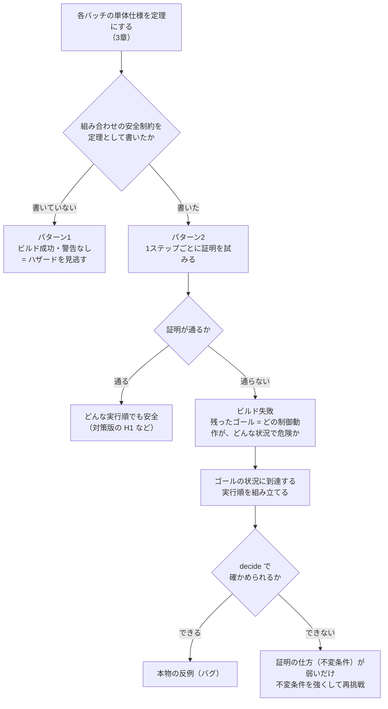

# 8. 証明の失敗からハザードを見つける（`Detect/`）

ソース：[`lean/Detect/WithoutConstraint.lean`](../lean/Detect/WithoutConstraint.lean)、[`lean/Detect/WithConstraint.lean`](../lean/Detect/WithConstraint.lean)、[`lean/Detect/Counterexample.lean`](../lean/Detect/Counterexample.lean)

## この章で言いたいこと

**組み合わせに対する安全制約を定理として書くと、ハザードはビルドの失敗として見つかる。** しかも、実行順を1本も列挙せずに見つかる。失敗した箇所が、どの制御動作がどんな状況で危険かを教えてくれるので、そこから反例（バグ）を組み立てられる。

逆に、**安全制約を書かなければ、ビルドは成功し、何も見つからない。**

この2つを比べるために、説明用のビルド対象を3つ用意した。どれも通常の `lake build`（CI）には含めていない。

| ビルド対象 | 中身 | 結果 |
|---|---|---|
| `DetectWithoutConstraint` | 各バッチの単体仕様だけ | ビルド成功。警告もなし |
| `DetectWithConstraint` | 組み合わせの安全制約を定理として書く | ビルド失敗。失敗箇所がハザードを指す |
| `DetectCounterexample` | 失敗箇所から組み立てた反例を確かめる | ビルド成功 |

```sh
cd renewal-notice/lean
lake build DetectWithoutConstraint
lake build DetectWithConstraint
lake build DetectCounterexample
```

## 全体の流れ



## パターン1：組み合わせの安全制約を書かない

### ここで言いたいこと

各バッチが単体で正しいことだけを定理にしても、組み合わせの問題は見つからない。単体テストがすべて通っても組み合わせの事故を見つけられないのと同じである。

```lean
/-- 対策なし版の4つのバッチは、すべての入力について単体仕様どおりに動く。 -/
theorem naive_units_correct :
    (∀ s u, (u ∈ (batchA s).tA.rows ↔ u ∈ s.world.users ∧ s.world.inactiveLog.contains u = true) ∧
            (batchA s).tA.asOf = s.today ∧ (batchA s).rA = .ok) ∧
    (∀ s u, (u ∈ (batchB s).tB.rows ↔ u ∈ s.world.users ∧ s.world.renewing.contains u = true) ∧
            (batchB s).tB.asOf = s.today ∧ (batchB s).rB = .ok) ∧
    (∀ s u, (u ∈ (batchC .naive s).tC.rows ↔ u ∈ s.tA.rows ∧ s.tB.rows.contains u = true) ∧
            (batchC .naive s).rC = .ok) ∧
    (∀ s, sentUsers (batchD .naive none s) = sentUsers s ++ s.tC.rows ∧
          (batchD .naive none s).rD = .ok) :=
  ⟨batchA_spec, batchB_spec, batchC_naive_spec, batchD_naive_spec⟩
```

読み方：対策なし版の A・B・C・D は、どれもすべての入力について単体仕様どおりに動く。証明は、[3章](03-spec.md)の4つの定理を並べただけである。

### ビルドの結果

```text
$ lake build DetectWithoutConstraint
✔ [39/41] Built Detect.WithoutConstraint (15s)
Build completed successfully (41 jobs).
```

**警告は1つも出ない。** Lean は書かれた主張しか検査しないので、組み合わせについて何も主張していなければ、何も言わない。

補足：通常の `lake build` でハザードの警告が出るのは、`Audit.lean`（[7章](07-build-audit.md)）の探索プログラムが安全制約 `sc1`〜`sc3` を使って調べているからである。安全制約を書いていなければ、その探索も書けない。

## パターン2：組み合わせの安全制約を定理として書く

### ここで言いたいこと

「対策なし版でも、どんな実行順でも安全制約が守られる」を定理として書き、対策版と同じ方針で証明を試みる。証明は通らず、通らなかった箇所がハザードを指す。

証明の方針は、[5章](05-safe-design.md)の対策版と同じ帰納法である。

1. 1ステップの補題：どの制御動作を1回実行しても、安全制約は保たれる
2. 帰納法：1ステップの補題を繰り返し使い、どんな長さの実行順でも保たれることを示す

この方法は、実行順を列挙しない。「すべての状態」と「制御動作の種類（7通り）」を記号的に扱うので、実行順の長さの上限もない。

### SC1：対象外の会員に送らない

```lean
/-- D を1回実行しても SC1 が保たれる。

対策版の `batchDSafe_sentOk` と同じ手順で証明を試みる。対策版では、送る相手（`pending`）を作るときに
`isTarget` を確かめているので最後のゴールが閉じる。対策なし版はそれを確かめていないので、
`(u, s.world.isTarget u).2 = true`（tC にいる u が本当の対象者であること）が証明できずに残る。 -/
theorem naive_D_preserves_sc1 (k : Option Nat) (s : State) (h : SentOk s) :
    SentOk (batchDNaive k s) := by
  intro p hp
  simp only [batchDNaive, List.mem_append, record, List.mem_map] at hp
  rcases hp with hp | ⟨u, hu, rfl⟩
  · exact h p hp
  · skip

/-- どの制御動作を1回実行しても SC1 が保たれる。D 以外は送信記録に触らないので証明できる。 -/
theorem naive_step_preserves_sc1 (s : State) (a : Action) (h : SentOk s) :
    SentOk (step .naive s a) := by
  cases a with
  | runA        => exact h
  | runB        => exact h
  | runC        => exact h
  | runD        => exact naive_D_preserves_sc1 none s h
  | crashD k    => exact naive_D_preserves_sc1 (some k) s h
  | use _       => exact h
  | breakSource => exact h

/-- 対策なし版でも、どんな実行順でも H1 は起きない（と主張する）。 -/
theorem naive_no_H1 (t : List Action) (s : State) (h : SentOk s) :
    SentOk (run .naive s t) := by
  induction t generalizing s with
  | nil => exact h
  | cons a t ih => exact ih _ (naive_step_preserves_sc1 s a h)
```

`naive_D_preserves_sc1` の証明は、対策版の `batchDSafe_sentOk`（[3章](03-spec.md)）と同じ手順で書いている。

1. 送信記録の任意の要素 `p` を取り出す
2. `p` は「元からあった記録」か「今回送った `(u, isTarget u)`」のどちらか
3. 元からあった記録なら、仮定 `h` で示せる
4. 今回送った記録なら、`u` が本当の対象者であることを示す必要がある。対策版はここで「送る相手を作るときに `isTarget` を確かめた」ことを使って閉じた。対策なし版には使える事実がないので、何も書けない（`skip`）

### SC2：同じ会員に重複して送らない

```lean
/-- 送信済みの一覧に重複がない（SC2 を命題にしたもの）。 -/
def SentNodup (s : State) : Prop := (sentUsers s).Nodup

/-- D を1回実行しても SC2 が保たれる。

今回送る相手の中に重複がないこと（`hk`）は仮定に置き、
「送信済みの人に、また送らないか」だけを問題にする。
対策版は送る相手から送信済みの人を除いている（`pending_not_sent`）ので証明できる。
対策なし版は除いていないので、「送信済みの人と、今回送る人が重ならない」が証明できずに残る。 -/
theorem naive_D_preserves_sc2 (k : Option Nat) (s : State) (h : SentNodup s)
    (hk : (limit k s.tC.rows).Nodup) :
    SentNodup (batchDNaive k s) := by
  simp only [SentNodup, sentUsers, batchDNaive, List.map_append, map_fst_record] at h ⊢
  rw [List.nodup_append]
  refine ⟨h, hk, ?_⟩
  skip
```

証明の手順：

1. 送信後の一覧は「送信済み ++ 今回送る人」になる
2. `List.nodup_append` で、「連結に重複がない」を「前半に重複がない」「後半に重複がない」「前半と後半が重ならない」の3つに分ける
3. 前半は仮定 `h`、後半は仮定 `hk` で示せる
4. 「前半と後半が重ならない」は、対策なし版には使える事実がないので、何も書けない（`skip`）

### ビルドの結果

```text
$ lake build DetectWithConstraint
✖ [39/41] Building Detect.WithConstraint (8.9s)
error: Detect/WithConstraint.lean:42:2: unsolved goals
case inr
k : Option Nat
s : State
h : SentOk s
u : User
hu : u ∈ limit k s.tC.rows
⊢ (u, s.world.isTarget u).snd = true
error: Detect/WithConstraint.lean:76:35: unsolved goals
k : Option Nat
s : State
h : (List.map (fun x => x.fst) s.sent).Nodup
hk : (limit k s.tC.rows).Nodup
⊢ ∀ (a : User), a ∈ List.map (fun x => x.fst) s.sent → ∀ (b : User), b ∈ limit k s.tC.rows → a ≠ b
error: build failed
```

`unsolved goals` は「証明しきれずに残った条件がある」という意味である。`⊢` の上が使える仮定、下が示すべきことである。

### エラーの読み方

| エラー | 使える仮定 | 示すべきこと | 意味 |
|---|---|---|---|
| 1つ目（SC1） | `hu : u ∈ limit k s.tC.rows`（u は tC にいる） | `(u, s.world.isTarget u).snd = true`（u は本当の対象者） | **D は tC にいる人に送るが、その人が本当の対象者だという保証がない** |
| 2つ目（SC2） | `h`（送信済みに重複はない）、`hk`（今回送る人に重複はない） | 送信済みの人と、今回送る tC の人は重ならない | **D は、すでに送った人にまた送らないという保証がない** |

注目すべき点が3つある。

- **エラーは D のところにしか出ていない。** A、B、C、利用再開、ログ故障の各ケースは証明が通っている。問題のある制御動作を、Lean が切り分けている
- **`naive_no_H1`（任意の長さで H1 が起きない）自体にはエラーが出ていない。** 帰納法の組み立ては正しく、1ステップの補題の D の部分だけが足りない、ということである
- **エラーの仮定と結論が、STPA の UCA の「状況」と「危険な制御動作」に対応している。** 1つ目は「tC に対象外の人がいる状況で D を出す」、2つ目は「tC に送信済みの人がいる状況で D を出す」

## 失敗したゴールから反例を組み立てる

### ここで言いたいこと

証明が通らないことは、まだ「ハザードがある」ことを意味しない。ゴールが求める状況（tC に対象外の人がいる、など）に、初期状態から実際に到達できなければ、それは証明の仕方（不変条件）が弱いだけかもしれない。

そこで、ゴールの状況に実際に到達する実行順を組み立て、`decide` で確かめる。確かめられれば、それが本物の反例（バグ）である。

### SC1 の反例

ゴールの状況は「tC に、本当の対象者でない会員がいる」。初期状態を見ると、前回サイクルの tC に会員0が残っていて、会員0は最近利用を再開したので対象外である。つまり、この状況は最初から成り立っている。

```lean
/-- 失敗したゴールが求める状況「tC に、本当の対象者でない会員がいる」は、初期状態ですでに成り立っている。
    前回サイクルの tC に残っている会員0は、最近利用を再開したので対象外である。 -/
theorem sc1_goal_reachable_at_init :
    0 ∈ init.tC.rows ∧ init.world.isTarget 0 = false := by decide

/-- したがって、初期状態で D を1回実行するだけで SC1 が破れる（H1）。 -/
theorem sc1_counterexample : sc1 (run .naive init [.runD]) = false := by decide
```

### SC2 の反例

ゴールの状況は「tC にいる会員が、すでに送信済み」。D を1回実行すると、会員0は送信済みになるが、tC は変わらず会員0を含んでいる。

```lean
/-- 失敗したゴールが求める状況「tC にいる会員が、すでに送信済み」は、D を1回実行した後に成り立つ。
    tC は変わらず会員0を含み、会員0はすでに送信済みである。 -/
theorem sc2_goal_reachable_after_D :
    0 ∈ (run .naive init [.runD]).tC.rows ∧ (sentUsers (run .naive init [.runD])).contains 0 = true := by
  decide

/-- したがって、D をもう1回実行すると SC2 が破れる（H2）。 -/
theorem sc2_counterexample : sc2 (run .naive init [.runD, .runD]) = false := by decide
```

### ビルドの結果

```text
$ lake build DetectCounterexample
✔ [39/41] Built Detect.Counterexample (1.7s)
Build completed successfully (41 jobs).
```

組み立てた反例 `[D]` と `[D, D]` は、[6章](06-counterexamples.md)の総当たり探索が見つけた最短の反例と同じである。探索をしなくても、証明の失敗から同じ反例にたどり着けた。

## 対策版では同じ証明が通る

同じ方針の証明を対策版に書いたものが、[5章](05-safe-design.md)の定理である。

| 安全制約 | 対策なし版（この章） | 対策版（5章） |
|---|---|---|
| SC1 | D の補題で証明が止まる（tC の人が対象者だという保証がない） | `batchDSafe_sentOk` → `safe_no_H1` で証明済み。送る直前に `isTarget` を確かめているから |
| SC2 | D の補題で証明が止まる（送信済みの人と重なる） | 1ステップの部分は `pending_not_sent` で証明済み。任意長の `safe_no_H2` は、tC に重複がないことの証明が残っていて未証明 |

証明が止まった箇所が、そのまま「対策で何を確かめればよいか」を示している。

## 総当たりの探索との比較

| | 総当たりの探索（6章） | 証明の失敗（この章） |
|---|---|---|
| 調べる範囲 | 長さ5以下の実行順（19,608本） | すべての状態 × 制御動作7種類。長さの上限なし |
| 分かること | 安全制約を破る実行順（反例そのもの） | どの制御動作が、どんな状況で安全制約を壊しうるか |
| 反例を得るには | そのまま使える | ゴールの状況に到達する実行順を組み立てて確かめる |
| 見逃し | 長さ6以上でしか起きないハザード | なし（ただし偽の警報がありうる。次節） |
| 偽の警報 | なし | 不変条件が弱いと、到達できない状況で証明が止まる |
| 手間 | 自動 | 証明を書く必要がある |

2つは補い合う。証明の失敗は長さに関係なく危険な箇所を指し、探索は具体的な反例をすぐに出す。

## 注意：証明が止まっても、ハザードとは限らない

1ステップの補題は「安全制約を満たす**任意の**状態から1ステップ進めても、安全制約が保たれる」と主張する。この「任意の状態」には、初期状態から実際には到達できない状態も含まれる。

そのため、到達できない状態のせいで証明が止まることがある（偽の警報）。その場合は、到達できる状態だけが満たす性質（不変条件）を仮定に加えて、証明をやり直す。[5章](05-safe-design.md)の UCA Timing の証明で、`FreshTC`（safe の C は日付を偽らない）を仮定に加えたのがその例である。

だからこそ、ゴールの状況に到達する実行順を組み立てて `decide` で確かめる手順が必要になる。確かめられた時点で、偽の警報ではなく本物のハザードだと分かる。

## SC3 について

SC3（全ジョブ正常終了なら、対象者全員に送られている）は、この章では扱っていない。SC3 は「1ステップで保たれる」形の性質ではないからである。たとえば、正常終了していない状態では SC3 は自動的に成り立つが、そこから C が正常終了しただけで、急に「全員送信済み」が求められる。

SC3 をこの方法で扱うには、「正常終了した D は、そのときの tC の対象者全員に送っている」のような、もっと強い不変条件を自分で考える必要がある。対策版の `safe_no_H3_without_fault` が未証明なのも、この不変条件がまだ見つかっていないからである。
