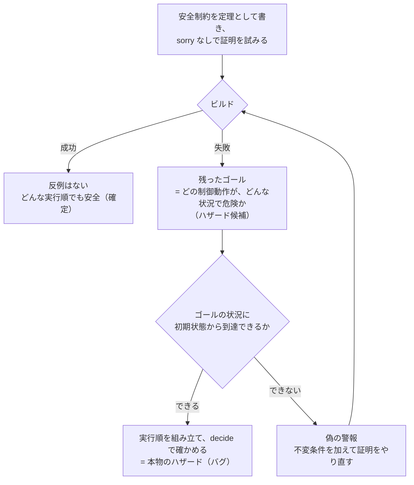

# 9. Lean を使う理由：反例が1つでもあれば、ビルドは必ず失敗する

この章は、ここまでの章（特に [5章](05-safe-design.md) と [8章](08-detect-by-proof-failure.md)）で見てきたことを、「なぜ Lean を使うのか」という観点でまとめる。

## 一言でいうと

**安全制約を定理として書き、`sorry` なしで証明を試みれば、反例が1つでもある限り、ビルドは必ず失敗する。しかも、無数の組み合わせを1つずつ調べずに、それが保証される。**

ただし、ビルドの失敗は「ハザード候補」である。残った条件から反例を組み立てて確かめると、本物のハザードになる。

## 1. 反例が1つでもあれば、ビルドは必ず失敗する

Lean は、偽の主張の証明を受け付けない。証明の各手順は、Lean のカーネル（小さく作られた、証明を検査する核の部分）がすべて検査する。主張が偽であれば、どんな証明を書いても検査を通らない。この性質を健全性という。

したがって、次の定理に反例（安全制約を破る実行順）が1つでもあれば、ビルドは必ず失敗する。

```lean
theorem naive_no_H1 (t : List Action) (s : State) (h : SentOk s) :
    SentOk (run .naive s t) := by
  ...
```

反例があるのにビルドが通る、という見逃しは起きない。

## 2. 無数の組み合わせを1つずつ調べていない

上の定理は「すべての実行順 `t`」について主張している。実行順は、長さに上限がなければ無数にある。

それでも証明が書けるのは、帰納法を使うからである。

1. **1ステップの補題**：安全制約を満たす任意の状態から、どの制御動作（7種類）を1回実行しても、安全制約は保たれる
2. **帰納法**：1ステップの補題を繰り返し使えば、何ステップ後でも保たれる

1ステップの補題は「すべての状態」を記号的に扱うので、状態を1つずつ試していない。制御動作の種類ごと（7通り）に場合分けするだけである。

| 方法 | 調べる範囲 | このプロジェクトでの例 |
|---|---|---|
| テスト | 書いた入力だけ | Go のテスト（記事のシナリオ A〜D と追加シナリオの8本） |
| 総当たりの探索 | 上限までのすべて | 長さ5以下の実行順 19,608本（[6章](06-counterexamples.md)） |
| 証明 | すべて（上限なし） | 制御動作7種類 × すべての状態（[5章](05-safe-design.md)、[8章](08-detect-by-proof-failure.md)） |

総当たりの探索は、長さ5以下で反例がなくても、長さ6以上で起きるハザードを見逃しうる。証明には、その上限がない。

## 3. ビルドの結果が意味すること

ビルドの結果と、実際に反例があるかどうかの関係は次のとおり。

| | ビルド成功 | ビルド失敗 |
|---|---|---|
| 反例がある（ハザードあり） | **起きない**（1の健全性による） | 起きる |
| 反例がない（ハザードなし） | 証明が書ければ成功 | 証明が足りなければ失敗（偽の警報） |

- **ビルドが成功したら**：反例はない。どんな実行順でも安全制約は守られる。これは確定である
- **ビルドが失敗したら**：反例があるかもしれないし、証明が足りないだけかもしれない。Lean はこの2つを区別できない。そのため、失敗は「ハザード候補」として扱う

## 4. ビルドの失敗から、本物のハザードを確かめる

ビルドが失敗したとき、Lean は反例そのものを返さない。返すのは「証明しきれずに残った条件（ゴール）」である。

[8章](08-detect-by-proof-failure.md)の例では、次のゴールが残った。

```text
hu : u ∈ limit k s.tC.rows
⊢ (u, s.world.isTarget u).snd = true
```

読み方：「D は tC にいる u に送るが、u が本当の対象者だという保証がない」。どの制御動作（D）が、どんな状況（tC に対象外の人がいる）で危険かが分かる。

そこから、本物のハザードかどうかを確かめる。

1. ゴールの状況に、初期状態から到達できるかを考える。この例では、前回サイクルの tC に対象外の会員0が残っているので、初期状態ですでに到達している
2. その状況で問題の制御動作を出す実行順を組み立てる。この例では `[D]`
3. `decide` で確かめる。確かめられれば、本物の反例（バグ）である

```lean
theorem sc1_counterexample : sc1 (run .naive init [.runD]) = false := by decide
```

到達できない状況でゴールが残っていた場合は、偽の警報である。到達できる状態だけが満たす性質（不変条件）を仮定に加え、証明をやり直す。[5章](05-safe-design.md)の `FreshTC` がその例である。



## 5. この保証が成り立つための条件

上の保証は、次の条件がそろったときに成り立つ。

| 条件 | 守れていないとどうなるか | このプロジェクトでの対策 |
|---|---|---|
| 安全制約を定理として書いている | 何も検査されない。ビルドは成功し、警告も出ない | [8章](08-detect-by-proof-failure.md)のパターン1で確認した |
| 証明を `sorry` で省略していない | 反例があってもビルドは失敗せず、警告が出るだけ | `Audit.lean` が `sorry` に依存する主張をすべて報告する（[7章](07-build-audit.md)） |
| 計算に頼る証明（`native_decide`）の扱いを分かっている | `native_decide` はコンパイラを信頼している。コンパイラに誤りがあれば保証が崩れる | `Audit.lean` が `native_decide` に依存する定理の数を報告する |
| モデルが実装と一致している | 保証はモデルについてのもの。実装がモデルと違えば、実装は保証されない | Lean の反例を Go のテストで再生している（[6章](06-counterexamples.md)） |
| 安全制約そのものが正しい | 意図と違う主張を証明しても意味がない | Lean Compass で人が確認すべき定義を絞り込む |

## 6. このプロジェクトで確かめたこと

| 主張 | ビルド | 意味 |
|---|---|---|
| 単体仕様だけ（`DetectWithoutConstraint`） | 成功・警告なし | 安全制約を書かなければ、ハザードがあっても何も見つからない |
| 対策なし版で「どんな実行順でも H1 が起きない」（`DetectWithConstraint`） | 失敗（D の箇所） | 反例があるので、必ず失敗する。ゴールから反例 `[D]` を組み立てられた |
| 対策なし版で「どんな実行順でも H2 が起きない」（`DetectWithConstraint`） | 失敗（D の箇所） | 同上。反例 `[D, D]` を組み立てられた |
| 対策版で「どんな実行順でも H1 が起きない」（`safe_no_H1`） | 成功 | 反例はない。無数の実行順について確定 |
| 対策版で「どんな実行順でも UCA Timing・Providing が起きない」 | 成功 | 同上 |
| 対策版で「どんな実行順でも H2 が起きない」（`safe_no_H2`） | 成功（`sorry` の警告あり） | 未証明。反例があるかどうかは、まだ分からない（長さ5以下ではない） |
