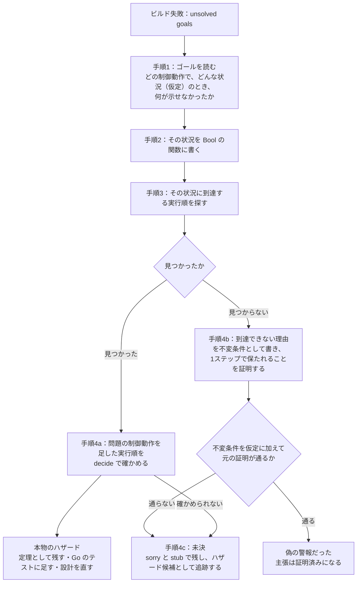

# 10. 実践での使い方：ビルドが失敗したときの切り分け

ソース：[`lean/Detect/WithConstraint.lean`](../lean/Detect/WithConstraint.lean)（本物のハザード）、[`lean/Detect/FalseAlarm.lean`](../lean/Detect/FalseAlarm.lean)（偽の警報）

## この章で言いたいこと

ビルドが失敗しても、反例があるとは限らない。失敗の理由は2つありうる。

- 本当に反例がある（ハザード）
- 主張は正しいが、証明に必要な事実が足りない（偽の警報）

Lean はこの2つを区別しない（[9章](09-why-lean.md)）。そのため、実践では**ビルドの失敗を「ハザード候補」として受け取り、手順に沿って切り分ける。** この章では、その手順を、このプロジェクトの実例（本物のハザードと偽の警報）で説明する。

## 1. まず、どの種類の失敗かを見る

ビルドの失敗やメッセージには、性質の違う3種類がある。最初にどれかを見分ける。

| 種類 | メッセージの例 | 偽の警報はありうるか | 次にすること |
|---|---|---|---|
| 計算で確かめる証明（`decide`、`native_decide`）の失敗 | `native_decide evaluated that the proposition ... is false` | **ない**。具体的な計算の結果なので、主張は本当に偽 | 反例の探索（`lake exe explore`）で、どの実行順かを特定する（[6章](06-counterexamples.md)） |
| 記号的な証明（帰納法など）の失敗 | `unsolved goals` と、残ったゴール | **ありうる** | この章の手順で切り分ける |
| `sorry` の警告（ビルドは成功） | `declaration uses 'sorry'`、`未証明の主張（ハザード候補）` | 判断していない状態 | 証明に挑戦するか、候補として追跡を続ける（4章の「未決」） |

対策版の `safe_bounded`（長さ5以下の全実行順で安全）は1つ目の種類である。これが失敗したら、偽の警報ではなく、長さ5以下に本物の反例がある。CI で最初に気づく失敗はこれになることが多い。

この章で扱うのは、2つ目の「記号的な証明の失敗」である。

## 2. 切り分けの手順



### 手順1：ゴールを読む

`unsolved goals` の後に、`⊢` の上に仮定、下に示せなかったことが表示される。これを次の3つに読み替える。

| 読み取るもの | どこを見るか |
|---|---|
| どの制御動作で止まったか | エラーが出た定理（どの制御動作の補題か）、`case` の名前 |
| どんな状況のときか | `⊢` の上の仮定 |
| 何が示せなかったか | `⊢` の下 |

### 手順2：その状況を Bool の関数に書く

仮定のうち、状態についての条件を、`State → Bool` の関数にする。

### 手順3：その状況に到達する実行順を探す

`#eval` で、状況に到達する最短の実行順を探す。ハザードそのものではなく、**ゴールが求める状況**を探すのがポイントである。

```lean
#eval (tracesUpTo alphabet 5).find? (fun t => 状況 (run 設計 init t))
```

### 手順4a：見つかった場合

見つかった実行順の後ろに、止まった制御動作を足し、安全制約が破れることを `decide` で確かめる。確かめられれば本物のハザードである。

本物と確定したら、次のことをする。

1. 反例を定理として残す（`Hazards.lean`）
2. Go のテストに同じ実行順を足す（`go/batch/system_test.go` の `scenarios`）
3. 設計を直す。直した設計で、止まった補題と同じ証明が通るかを確かめる

### 手順4b：見つからない場合

長さ5以下では到達しないので、偽の警報の疑いがある。到達できない理由を「すべての到達可能な状態が満たす性質（不変条件）」として書き、次の2つを証明する。

1. 初期状態は不変条件を満たす
2. 不変条件を満たす状態から、どの制御動作を1回実行しても、不変条件は保たれる

証明できたら、元の補題の仮定に不変条件を加えて、証明をやり直す。通れば偽の警報だったことになり、元の主張も証明済みになる。

### 手順4c：どちらもできない場合

反例も不変条件も見つからなければ、未決である。主張は `sorry` のまま残し、`@[proof_progress stub]` を付けてハザード候補として追跡する。`safe_bounded` のような有界検査で、長さ5以下には反例がないことだけは確かめておく。

## 3. 例1：本物のハザード（対策なし版の D と SC1）

[8章](08-detect-by-proof-failure.md)の `lake build DetectWithConstraint` の失敗を、手順どおりに切り分ける。

### 手順1：ゴールを読む

```text
error: Detect/WithConstraint.lean:42:2: unsolved goals
case inr
k : Option Nat
s : State
h : SentOk s
u : User
hu : u ∈ limit k s.tC.rows
⊢ (u, s.world.isTarget u).snd = true
```

| 読み取るもの | 内容 |
|---|---|
| どの制御動作か | `naive_D_preserves_sc1` なので、D |
| どんな状況か | `hu`：u は tC にいる |
| 何が示せなかったか | u が本当の対象者であること |

つまり「tC に本当の対象者でない人がいる状況で D を出すと、SC1 が破れるかもしれない」。

### 手順2・3：状況を関数にして、到達する実行順を探す

```lean
#eval (tracesUpTo alphabet 5).find?
  (fun t => let s := run .naive init t; s.tC.rows.any (fun u => !s.world.isTarget u))
-- some []
```

`some []` は「空の実行順（初期状態）で、すでにその状況にある」という意味である。前回サイクルの tC に、対象外の会員0が残っている。

### 手順4a：確かめる

初期状態に D を足した `[D]` で、SC1 が破れることを確かめる（[`Detect/Counterexample.lean`](../lean/Detect/Counterexample.lean)）。

```lean
theorem sc1_counterexample : sc1 (run .naive init [.runD]) = false := by decide
```

ビルドが通るので、本物のハザードである。このプロジェクトでは、次のように対応した。

| 対応 | どこに |
|---|---|
| 反例を定理として残す | `Hazards.lean` の `H1_onlyD` |
| Go のテストに足す | `system_test.go` の「追加: Dだけ」 |
| 設計を直す | 対策版の D は、送る直前に `isTarget` を確かめる（`pending`）。同じ形の補題 `batchDSafe_sentOk` が証明できた |

## 4. 例2：偽の警報（対策版の UCA Timing、不変条件なし）

### 何をしたか

対策版で「1回の制御動作で UCA Timing は起きない」を、不変条件を仮定に加えずに証明しようとした（[`Detect/FalseAlarm.lean`](../lean/Detect/FalseAlarm.lean)）。

```lean
theorem safe_uca_timing_step_without_invariant (s : State) (a : Action) :
    ucaTiming .safe s a = false := by
  unfold ucaTiming newSends
  rcases safe_step_sent s a with hs | ⟨hd, k, hs⟩
  · simp [hs]
  · rw [hs, List.drop_left, map_fst_record]
    skip
```

```sh
lake build DetectFalseAlarm
```

### 手順1：ゴールを読む

```text
error: Detect/FalseAlarm.lean:34:2: unsolved goals
case inr
s : State
a : Action
hd : s.tC.asOf = s.today
k : Option Nat
hs : (step Design.safe s a).sent = s.sent ++ record s (limit k (pending s))
⊢ (s.tCInputsAsOf != s.today && !(limit k (pending s)).isEmpty) = false
```

| 読み取るもの | 内容 |
|---|---|
| どの制御動作か | 送信が起きる動作（D） |
| どんな状況か | `hd`：tC には今日の日付が付いている |
| 何が示せなかったか | 「tC が実際には古い表から作られている、かつ誰かに送る」が起きないこと |

つまり「tC に今日の日付が付いているのに、実際は古い表から作られている状況で D を出すと、UCA Timing になるかもしれない」。

### 手順2・3：状況を関数にして、到達する実行順を探す

```lean
def staleButStamped (s : State) : Bool := s.tC.asOf == s.today && s.tCInputsAsOf != s.today

#eval (tracesUpTo alphabet 5).find? (fun t => staleButStamped (run .safe init t))
-- none
```

対策版では、ログ故障を含む7種類の動作で、長さ5以下のどの実行順でも到達しない。

比較のため、対策なし版で同じことを調べると、すぐに到達する。

```lean
#eval (tracesUpTo alphabet 5).find? (fun t => staleButStamped (run .naive init t))
-- some [RenewalNotice.Action.runC]
```

対策なし版の C は、古い表からでも今日の日付を付けるからである。

### 手順4b：不変条件を書いて証明する

到達できない理由は「対策版の C は、入力が今日のものでなければ tC を作らない」ことである。これを不変条件にする（[`Scenarios.lean`](../lean/RenewalNotice/Scenarios.lean)）。

```lean
/-- tC に今日の日付が付いているなら、本当に今日の A・B の結果から作られている。 -/
def FreshTC (s : State) : Prop := s.tC.asOf = s.today → s.tCInputsAsOf = s.today
```

次に、どの制御動作でも保たれることを証明する。これは [5章](05-safe-design.md)の `step_safe_freshTC` で証明済みである。初期状態は tC の日付が0（今日は1）なので、自動的に満たす。

最後に、元の補題の仮定に `FreshTC` を加えると、証明が通る。

```lean
theorem safe_no_uca_timing_step (s : State) (a : Action) (h : FreshTC s) :
    ucaTiming .safe s a = false := by
  unfold ucaTiming newSends
  rcases safe_step_sent s a with hs | ⟨hd, _, _⟩
  · simp [hs]
  · simp [h hd]
```

止まっていた箇所が、`h hd`（tC に今日の日付が付いているなら、`tCInputsAsOf` も今日）で閉じる。偽の警報だったことが確定し、元の主張「どんな実行順でも UCA Timing は起きない」（`safe_no_uca_timing`）も証明済みになった。

## 5. 例3：未決（対策版の H2）

対策版で「どんな実行順でも重複送信は起きない」（`safe_no_H2`）は、まだ切り分けが終わっていない。

| 手順 | 状況 |
|---|---|
| 反例を探す | 長さ5以下では見つからない（`safe_bounded` で確認済み） |
| 不変条件を探す | 「tC に同じ会員が2回入らない」「送信済みの一覧に重複がない」が必要そうだが、まだ証明していない |

そのため、`sorry` と `@[proof_progress stub]` で残している。

```lean
@[formalMeta "対策版にH2なし（未証明）" "どんな長さの実行順でも、同じ会員に重複して送らない" "記事 H2 が起きない（記事の安全制約）：未証明＝ハザード候補" mainTheorem,
  confidence medium, proof_progress stub]
theorem safe_no_H2 (t : List Action) : sc2 (run .safe init t) = true := by
  sorry
```

この状態は、ビルドのたびに `未証明の主張（ハザード候補）` として報告され（[7章](07-build-audit.md)）、Lean Atlas でも「sorryあり」として表示される。

## 6. 3つの例のまとめ

| | 例1：本物のハザード | 例2：偽の警報 | 例3：未決 |
|---|---|---|---|
| ビルド対象 | `DetectWithConstraint` | `DetectFalseAlarm` | 通常の `lake build`（`sorry` の警告） |
| 止まった箇所 | 対策なし版の D | 対策版の D（不変条件なし） | （証明に挑戦していない） |
| ゴールの状況 | tC に対象外の人がいる | tC の日付は今日だが、実際は古い | — |
| 状況に到達するか | 初期状態で到達（`some []`） | 長さ5以下では到達しない（`none`） | 長さ5以下では反例なし |
| 結論 | `[D]` を `decide` で確かめ、ハザード確定 | 不変条件 `FreshTC` を加えて証明が通り、偽の警報と確定 | `sorry` のまま追跡 |

## 7. チームでの運用

### どこに何を置くか

| 置くもの | 置き場所 | 通常の `lake build`（CI）に含めるか |
|---|---|---|
| 証明済みの安全性 | `SafeDesign.lean` | 含める（壊れたらビルドが失敗する） |
| 確定したハザード（反例） | `Hazards.lean` | 含める（ハザードが消えたらビルドが失敗する） |
| 未決のハザード候補 | `SafeDesign.lean` に `sorry` と `stub` で | 含める（警告として報告される） |
| 切り分け中の証明の試み | `Detect/` に別のビルド対象として | 含めない（失敗しても CI を止めない） |

### 変更を入れたときの流れ

1. バッチの実装（Go）を変えたら、Lean のモデルも同じように変える
2. CI で `lake build` が走る
   - `safe_bounded` が失敗したら：長さ5以下に本物の反例がある。`lake exe explore` で実行順を特定する
   - 証明済みの帰納法の定理が失敗したら：ゴールを読み、この章の手順で切り分ける。切り分けの作業は `Detect/` に別のビルド対象を作って行う
   - 新しい `sorry` の警告が出たら：ハザード候補が増えた。Lean Atlas で一覧を確認する
3. Go のテストが、Lean の反例を実装で再生する。失敗したら、モデルと実装がずれている

### 判断の目安

- **ゴールの状況に初期状態から到達できるかが、本物か偽の警報かの分かれ目になる。** まず `#eval` と `tracesUpTo` で、状況に到達する実行順を探す
- 到達する実行順が見つかっても、最後の制御動作で本当に安全制約が破れるかは `decide` で確かめる。到達するだけでは確定しない
- 長さ5以下で到達しないことは、到達できないことの証明ではない。不変条件を証明して初めて、偽の警報と確定する
