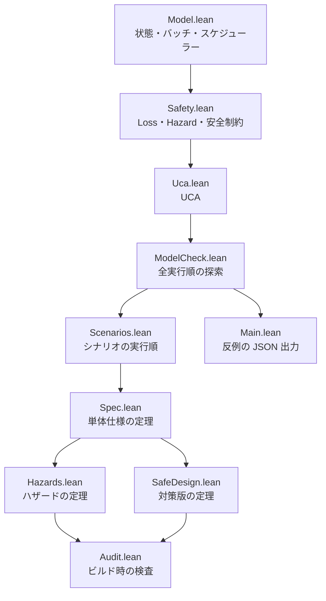

# Lean ソースコード解説

`renewal-notice/lean/` の Lean コードを、ファイルごとに解説する。
各節は次の順で書いている。

1. **ここで言いたいこと**：その定理や定義で、何を示したいのか
2. **コード**：実際のソースから切り出したもの（省略していない）
3. **読み方**：主張を日本語に直したもの
4. **証明の中身**：証明の各行が何をしているか

題材は [STAMP/STPA を SRE の視点で解説した記事](https://zenn.dev/maruloop/articles/7ff108e29741b5)（以下、元記事）の退会案内アプリ。

## 読む順番

| 順 | ドキュメント | 対応するソース | 内容 |
|---|---|---|---|
| 0 | [00-lean-basics.md](00-lean-basics.md) | なし | このコードを読むのに必要な Lean の文法と証明の書き方 |
| 1 | [01-model.md](01-model.md) | `Model.lean` | アプリのモデル。状態、バッチ、スケジューラー、初期状態 |
| 2 | [02-safety-and-uca.md](02-safety-and-uca.md) | `Safety.lean`、`Uca.lean` | 元記事の Loss・Hazard・UCA を定義にする |
| 3 | [03-spec.md](03-spec.md) | `Spec.lean` | 各バッチは単体では正しい（定理） |
| 4 | [04-hazards.md](04-hazards.md) | `Scenarios.lean`、`Hazards.lean` | それでも組み合わせると危険（定理） |
| 5 | [05-safe-design.md](05-safe-design.md) | `SafeDesign.lean` | 対策版の安全性。帰納法、有界検査、未証明の主張 |
| 6 | [06-counterexamples.md](06-counterexamples.md) | `ModelCheck.lean`、`Main.lean` | 反例の探索と、反例の JSON 出力 |
| 7 | [07-build-audit.md](07-build-audit.md) | `Audit.lean` | `lake build` でハザード検出と証明状況の照合を行う仕組み |
| 8 | [08-detect-by-proof-failure.md](08-detect-by-proof-failure.md) | `Detect/*.lean` | 組み合わせの安全制約を定理にすると、ビルドの失敗としてハザードが見つかる。安全制約がなければ何も見つからない。失敗箇所から反例を組み立てる |
| 9 | [09-why-lean.md](09-why-lean.md) | なし | Lean を使う理由。反例が1つでもあればビルドは必ず失敗し、しかも組み合わせを1つずつ調べずに済む。ビルドの結果が意味することと、保証の条件 |
| 10 | [10-practice.md](10-practice.md) | `Detect/*.lean` | 実践での使い方。ビルドが失敗したとき、本物のハザードか偽の警報かを切り分ける手順。3つの実例（本物・偽の警報・未決）とチームでの運用 |

## ファイルの依存関係



`Model` から `Scenarios` までは定義（プログラム）だけで、主張（定理）はほとんど置いていない。
定理は `Spec`、`Hazards`、`SafeDesign` に置き、Lean Atlas の注記（`@[formalMeta ...]` など）を付けている。

## 動かし方

```sh
cd renewal-notice/lean
lake build                                    # 全定理の検査、ハザード検出、証明状況の照合
lake exe explore > out/counterexamples.json   # 反例を JSON に書き出す
lake build DetectWithoutConstraint            # 8章：安全制約なし → ビルド成功（何も見つからない）
lake build DetectWithConstraint               # 8章：安全制約あり → ビルド失敗（ハザードの箇所が出る）
lake build DetectCounterexample               # 8章：失敗箇所から組み立てた反例を確かめる
lake build DetectFalseAlarm                    # 10章：偽の警報の例（主張は正しいが、不変条件がなく証明が止まる）
```

途中の値を確かめたいときは、`#eval` を書いたファイルを作って `lake env lean <ファイル>` で実行できる。

```lean
import RenewalNotice
open RenewalNotice
#eval (run .naive init scenarioA).sent   -- [(0, false), (1, true)]
```
